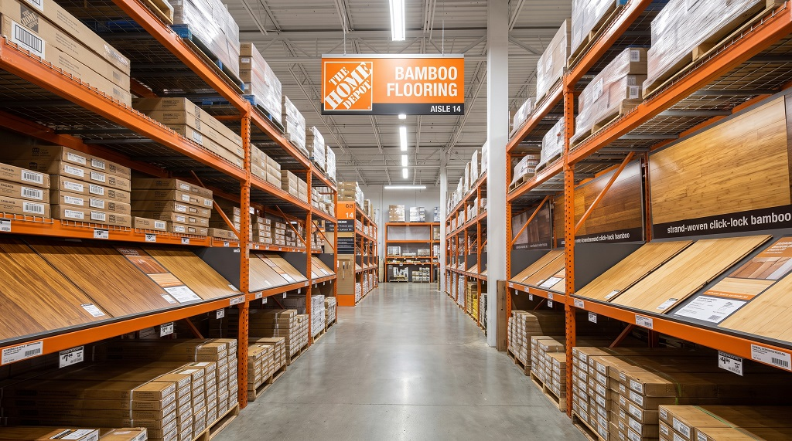
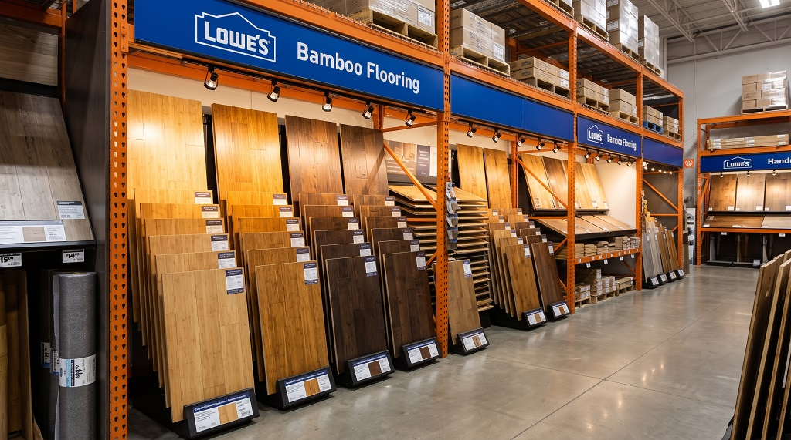
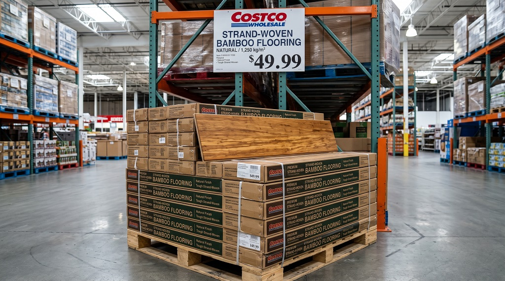

In 2026, bamboo flooring materials cost between $2.00 and $10.00 per square foot across major U.S. retailers, while fully installed projects average $7.00 to $20.00 per square foot depending on plank construction, subfloor prep, and regional labor rates. For an average 250-square-foot living room or primary bedroom, most homeowners spend around $3,400 from start to finish, with budget floating jobs landing near $1,750 and thick nail-down strand-woven installations climbing past $5,000.

Shopping for bamboo flooring at big-box stores rarely works the way price tags suggest. The shelf sticker only tells part of the story. Home Depot relies heavily on house brands priced aggressively between $2.99 and $4.00 per square foot, Lowe's leans into national brand partnerships like CALI that stretch up to $7.99 per square foot, and Costco skips the permanent flooring aisle altogether in favor of member-only direct drops and turnkey installation rebates. Knowing what each store actually stocks—and where hidden fees creep in—saves hundreds of dollars before you load a single carton onto a flatbed cart.

## What Bamboo Flooring Really Costs in 2026

Before comparing retailers side by side, it helps to separate bamboo flooring into its four core constructions. A $2.99 click-lock plank and a $6.99 solid plank may sit three feet apart on the same showroom rack, yet they behave like completely different materials once installed.

Engineered bamboo sits at the entry tier, running $2.00 to $5.00 per square foot for materials. Manufacturers bond a thin real bamboo wear layer over a multi-ply hardwood, eucalyptus, or rigid mineral composite core. Because the cross-layered core resists seasonal expansion better than solid strips, engineered planks work well over concrete slabs and radiant heating systems.

Traditional horizontal and vertical solid bamboo fall in the middle. Horizontal planks showcase the classic bamboo knuckle pattern and average $3.00 to $6.00 per square foot. Vertical planks laminate thin strips on edge for a cleaner, linear grain, typically pricing between $4.00 and $10.00 per square foot depending on thickness and mill quality. Both offer hardness roughly comparable to red oak, though softer carbonized finishes dent more easily under dropped cookware or pet claws.

Strand-woven bamboo dominates modern retail shelves and ranges from $4.00 to $10.00 per square foot. Producers shred mature Moso bamboo stalks into fibers, bind them with low-VOC resins under extreme heat and hydraulic pressure, and press them to an indoor flooring density around 1,050 kg/m³. That compression pushes Janka hardness scores well past 2,500 pounds-force—often double the hardness of traditional oak—making strand-woven the practical baseline for busy hallways, family rooms, and homes with dogs.

## Home Depot Bamboo Flooring Prices

The Home Depot offers the deepest everyday stock of budget-to-midrange bamboo flooring among the three retailers. Rather than stocking dozens of independent specialty brands, Home Depot concentrates its catalog around exclusive private labels and controlled supplier lines, keeping core pricing clustered between $2.99 and $4.95 per square foot.

### Home Depot House Brands

Home Decorators Collection anchors Home Depot's bamboo aisle. In 2026, core 3/8-inch and 1/2-inch click-lock strand-woven options list between $2.99 and $3.90 per square foot, translating to roughly $77 to $101 per carton depending on square-foot coverage. Wide-plank choices such as the Strand Woven Baydon 1/2-inch by 7.2-inch click-lock plank sell near $3.51 per square foot ($90.56 per 25.81-square-foot case), while thicker specialty finishes in the same label reach $5.99 per square foot.

For homeowners worried about kitchen spills or half-bath moisture, Lifeproof carries waterproof prefinished click-lock bamboo built on a 9/32-inch rigid core. Real shelf prices stay tightly grouped between $3.88 and $4.00 per square foot—for example, Berkeley at $3.89 per square foot ($60.10 per 15.5-square-foot case), Bay Point and Charlestone at $3.88 per square foot ($50.84 per 13.1-square-foot case), and Mojave at $4.00 per square foot. While the waterproof core blocks liquid from swelling the backing, thinner top veneers mean Lifeproof handles moisture better than heavy rolling impacts.

Home Depot also fills gaps online through exclusive third-party lines like HomeLegend and Selkirk Floors. HomeLegend distressed 3/8-inch strand-woven planks list around $3.85 per square foot, stepping up to $4.95 per square foot for 9/16-inch solid tongue-and-groove planks. Selkirk Floors 1/2-inch tongue-and-groove strand-woven styles generally sit between $4.09 and $4.55 per square foot, while boutique solid tongue-and-groove imports sold via Home Depot's online marketplace reach $6.29 to $7.95 per square foot.

### Return and Install Policies

Home Depot gives DIY buyers a 90-day return window on unopened boxed flooring, extending to 365 days when purchased on a Home Depot credit account. Free ship-to-store pickup is standard on almost every online SKU, which cuts out residential freight surcharges that can otherwise add $150 to $300 on palletized deliveries. If you bundle installation through Home Depot's local contractor network, the work carries a one-year labor warranty, and a technician performs a pre-install subfloor moisture and flatness inspection. Keep in mind that installed flooring cannot be returned under satisfaction guarantees—only documented manufacturing defects qualify for warranty claims.

## Lowe's Bamboo Flooring Prices

Lowe's approaches bamboo flooring with a sharper split between value private-label planks and premium branded flooring. Across its 2026 catalog, prices span $2.00 to $7.99 per square foot, giving shoppers a clearer step up in plank thickness, wear-layer finish, and long-term structural warranties compared to economy warehouse staples.

### Lowe's Brand Lineup

At the accessible end of the bay, Lowe's house brand allen + roth covers roughly $2.00 to $4.99 per square foot. Standout lines include the Caramel Carbonized 9/16-inch by 3-3/4-inch solid tongue-and-groove bamboo (23.8 square feet per carton) for traditional nail-down installs, alongside handscraped Rustic Brown and wirebrushed Logan Gray interlocking engineered bamboo planks in 5-1/8-inch widths (20.49 square feet per carton). These engineered locking options rate high on Lowe's Janka hardness scale while keeping carton costs approachable for whole-home remodels.

Where Lowe's separates itself from Home Depot is its long-standing partnership with CALI, one of the most recognized bamboo flooring brands in North America. CALI's Fossilized line—including Mocha, Natural, Antique Java, and Treehouse in both 7/16-inch and 9/16-inch thicknesses—typically runs $3.50 to $8.00 per square foot, with full 9/16-inch wide engineered and solid Fossilized planks most commonly sitting between $5.00 and $7.99 per square foot. CALI backs its Fossilized strand-woven products with a 50-year residential warranty, GREENGUARD Gold indoor air quality certification, and Janka ratings exceeding 2,500. For wet spaces, Lowe's also lists rigid-core waterproof bamboo hybrids like Hydri-HDPC, pairing a real strand bamboo surface with a high-density plastic composite core.

Buyers eyeing CALI at Lowe's should always cross-check Lowe's in-store pricing against direct quotes from CALI. Because Lowe's carries a recognized national brand rather than a store-locked private label, seasonal manufacturer promotions or contractor volume discounts sometimes shift which channel delivers the lower landed cost once matching stair noses and reducers are added.

### Special Order Restocking Rules

Lowe's matches Home Depot's 90-day, zero-restocking-fee return window on stocked boxed flooring. The catch shows up on special-order bamboo—which covers a large share of CALI's wider-plank finishes and matching trim moldings. Special-order items drop to a 30-day return window and carry a 20 percent restocking fee. Ordering an extra box or two to protect against dye-lot shortages is smart practice, so verify whether your chosen colorway is regular store stock or a special-order SKU before checking out. Bundled Lowe's installations include a one-year labor warranty.

## Costco Bamboo Flooring Prices

Shoppers walking into a Costco warehouse expecting a full aisle of bamboo samples usually leave empty-handed. Unlike Home Depot and Lowe's, Costco does not carry a permanent multi-brand bamboo selection year-round. Instead, Costco delivers bamboo flooring through three distinct channels, each with its own pricing mechanics and trade-offs.

### How Costco Sells Bamboo

The primary channel for bamboo buyers is Costco Next, Costco's member-direct marketplace featuring Golden Arowana flooring. Through Costco Next, members purchase strand-woven and rigid-core bamboo directly from the supplier at member-negotiated pricing that frequently undercuts comparable big-box national brands, commonly landing in the $2.50 to $4.50 per square foot range depending on plank construction, attached underlayment, and seasonal instant rebates.

Occasionally, regional Costco warehouses also bring in limited-run pallet drops of Golden Arowana strand-woven click-lock bamboo. When those pallets hit the floor, per-box pricing is tough to beat—often dipping near the $2.50 to $3.25 per square foot mark during coupon book events. The risk is supply continuity. Once a warehouse pallet sells through, Costco rarely restocks the exact same dye lot or locking profile. If you underestimate your square footage or damage two planks during installation, finding a matching box six months later can become impossible.

Costco's third path is Costco Home Services, partnered primarily with Shaw Custom Flooring. Rather than selling loose DIY cartons, this turnkey program pairs in-home measurement with professional installation, typically landing between $5.00 and $12.00 per square foot installed across hardwood and engineered options. Qualifying pretax installed orders earn a 10 percent Costco Shop Card rebate, which effectively trims $500 off a $5,000 flooring contract—though actual bamboo availability under the Shaw program varies by local participating flooring dealer.

### Membership Return Fine Print

Standard boxed flooring bought inside a Costco warehouse benefits from Costco's famously flexible satisfaction guarantee, giving buyers peace of mind on unopened excess cartons. However, purchases made through Costco's Special Order Kiosk or installed custom flooring programs fall outside the standard warehouse return window. Once planks are nailed, glued, or floated by an installer, warranty coverage shifts exclusively to the manufacturer and installation partner.

## Hidden Costs Beyond the Shelf Tag

Comparing $3.50 at Home Depot against $5.49 at Lowe's only addresses half of your real budget. In 2026, materials typically account for just 40 to 55 percent of a professionally installed bamboo flooring bill.

### Labor and Tear-Out Rates

National labor rates for bamboo flooring installation average $3.00 to $10.00 per square foot. Simple floating click-lock installs over a clean, flat subfloor sit on the lower end—usually $2.75 to $4.50 per square foot—while glue-down concrete installations or nail-down solid 9/16-inch strand-woven planks push labor toward $5.00 to $10.00 per square foot because dense bamboo dulls saw blades rapidly and demands specialized 18-gauge cleats rather than standard flooring staples.

Removing old flooring adds another layer to the invoice. Tearing out carpet and padding generally runs $0.35 to $1.60 per square foot, whereas pulling up glued hardwood, tile, or staples-packed underlayment reaches $2.25 per square foot or more, plus $145 to $200 for debris haul-away. If your subfloor dips more than 3/16 inch over a 10-foot span, self-leveling compound and grinding can add $1.50 to $3.00 per square foot before the first bamboo plank comes out of its carton.

### Underlayment, Trim, and Overage

Floating bamboo floors require a quality underlayment with an integrated vapor barrier, especially over concrete slabs. Basic moisture barriers start near $0.30 per square foot, while dense acoustic pads for condos and second-story rooms cost $0.80 to $1.50 per square foot. Glue-down installs swap underlayment for moisture-cure urethane adhesive, which easily adds $1.25 to $2.00 per square foot in pails and trowels.

Coordinating transition strips—T-moldings, reducers, thresholds, and flush stair noses—regularly catch first-time buyers off guard. A single matching bamboo stair nose often runs $45 to $85, and replacing baseboards adds roughly $5.70 to $8.95 per linear foot when installed by a finish carpenter. Finally, always add 7 to 10 percent extra square footage for cutting waste and color culling, bumping that buffer to 12 or 15 percent if you buy a limited-run Costco pallet or lay planks diagonally.

## Choosing the Right Store in 2026

Each retailer fits a distinct project profile once you look past headline square-foot numbers. Home Depot makes the most sense for budget-conscious DIYers and fast turnarounds, thanks to deep everyday inventory in the $2.99 to $4.00 range, easy store pickup, and a forgiving return window on leftover boxes. Lowe's earns the nod when you want thicker 9/16-inch strand-woven planks, GREENGUARD Gold certification, and long-term brand backing from CALI without navigating an independent distributor—provided you watch out for that 20 percent restocking fee on special orders. Costco works best for flexible buyers who spot an active Costco Next promotion or want a turnkey installed package where the 10 percent Shop Card rebate offsets professional labor. Order physical samples from your top two contenders, acclimate them in the room for at least 72 hours, and total the full bill—planks, trim, underlayment, and labor—before committing to a single retailer.