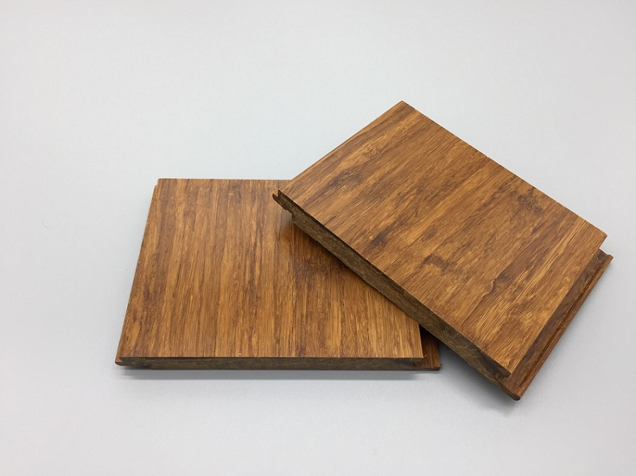
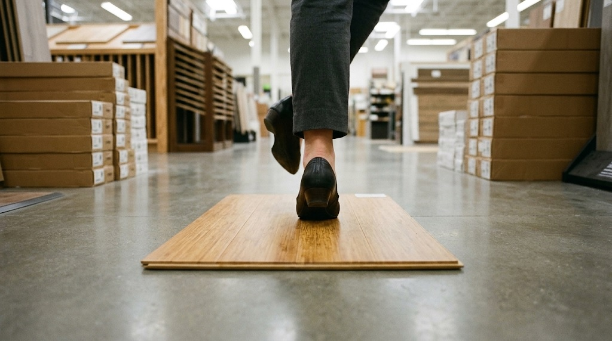
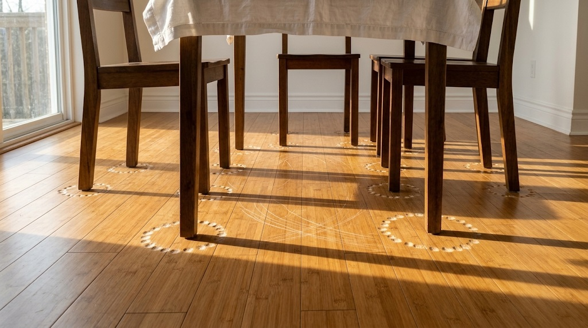
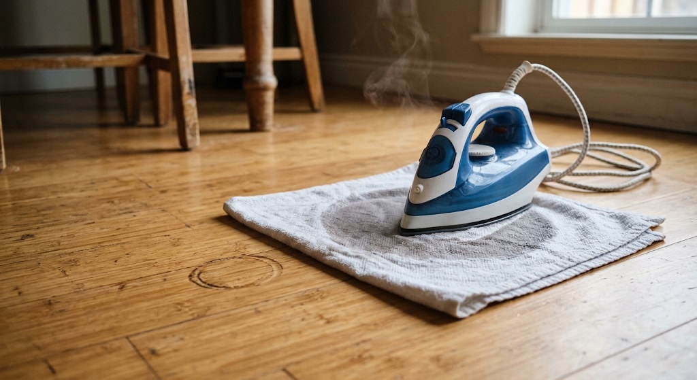

You cannot tell a soft bamboo floor by touching it. The finish feels the same on a dense strand woven board and on a low-density horizontal plank, and both survive a hand rub without complaint. The difference appears about eighteen months later, as a ring of shallow craters under the dining chairs, and by then the money is spent.

The number that predicts denting is density. Horizontal and vertical bamboo typically runs between 600 and 700 kilograms per cubic meter. Strand woven bamboo is pressed to roughly 1000 to 1200. A board below 700 will dent under ordinary furniture loads. A board above 1000 will resist most of them. Everything else on the label, including the finish, matters far less than that one figure.

## Why Bamboo Gives Way Under Load

Bamboo is a grass, and its structure is not wood. The fibers run lengthwise in a hard outer wall, with a softer pith between the nodes. When those strips are glued flat into a board, that softer material ends up in the middle of the plank, directly beneath the surface you walk on.

### The soft layer sits under your feet

In a horizontal plank, the wide face of the strip becomes the wear surface, and the pith side sits just below it. Press hard enough and the pith compresses before the fibers do. This is why a horizontal bamboo floor can look flawless and still take a heel mark in the first month.

### Strand woven rearranges the fibers

Strand woven bamboo shreds the strips into fibers, mixes them with resin, and presses the mass into a block under heat. The result has no soft layer to collapse. Fibers run in every direction, packed tight, and the surface compresses far less under a point load.

## Carbonized Bamboo Dents Sooner

Carbonization is a heat treatment that darkens the bamboo by caramelizing the sugars in the fiber. It also weakens the material. A carbonized board of the same construction is measurably softer than a natural one, often by twenty to thirty percent, and it dents sooner under the same traffic.

This matters because carbonized colors are the ones people choose. A deep amber floor hides dirt, matches older furniture, and photographs well in a listing. If the color is the reason for the purchase, buy it in strand woven rather than horizontal and you recover most of the hardness the treatment removed.

## Three Tests You Can Run in the Store

### The thumbnail test

Take a loose sample, lay it on a solid counter, and press your thumbnail into the surface at a slight angle with real force. A dense strand woven board resists and leaves almost nothing. A soft horizontal plank takes a visible crescent mark that fades slowly. Do it near the edge as well as the center, because density is often lower there.

### The weight test

Pick up two samples of the same size and thickness. The heavier one is denser, almost every time. A five-eighths inch strand woven plank has noticeable heft, the way a good hardwood board does. A soft plank feels light and slightly hollow, and that lightness is the pith and the air still inside it.

### The heel test

Lay a sample flat on the floor and stand on it on one heel, with your full weight on that small contact point. This simulates the worst case a residential floor sees, which is a person in heels or a chair leg with a missing glide. A soft board will flex visibly and may mark. A dense one will not move.

## Reading the Specification Sheet

The spec sheet is where soft floors hide. Ask for density in kilograms per cubic meter or pounds per cubic foot, and ask whether the Janka figure quoted applies to the exact product in front of you or to bamboo in general.

### What the numbers should say

Strand woven bamboo should list density above 1000 kilograms per cubic meter and a Janka rating in the low thousands, well above red oak at roughly 1290. Horizontal and vertical bamboo should list 600 to 700 and a Janka near red oak. If the sheet lists no density at all, that absence is information.

### The solid bamboo trick

A board can be called solid bamboo and still be three-eighths of an inch thick with a bamboo core and a thin face. Read the thickness and construction, not the word solid. Thicker boards dent less visibly because there is more material to absorb the load before it reaches the joint.

## Where Denting Actually Happens

Kitchens take the worst of it, from dropped cans, cast iron, and the leveling feet of a refrigerator that was never set properly. Dining chairs without felt glides are the single most common cause of a ring of dents in a dining room. A piano, a heavy desk, and a treadmill all concentrate load on four small points.

High heels are the classic culprit in photographs of damaged floors. The load is small but the pressure is extreme, and no residential finish prevents it. Felt pads under every leg, plus a mat at the sink, remove most of the risk for a few dollars.

Homes on a slab need one extra thought. Concrete wicks moisture and stays cool, so a bamboo floor over slab should be glued down with a moisture barrier rather than floated, and the slab should be tested for vapor emission before anything goes on it. A floor that takes on moisture from below softens from the inside, and a soft core dents under loads that a dry board would shrug off. The dent you see on the surface can be the last symptom of a problem that started six months earlier under the plank.

## Floating or Glued Down Changes How It Feels

A floating floor sits on a foam underlayment with a small air gap beneath. When weight lands on it, the board flexes slightly before the subfloor stops it, and that movement makes a dent feel deeper than it measures. A glued-down floor transfers load straight into the subfloor and feels dead solid underfoot.

The material is the same in both cases, so the density test still decides. But if the floor is going in a room with heavy furniture and the choice is between floating a soft board and gluing down a dense one, the glued installation will feel better even before it wears.

## If the Floor Already Dents

A shallow dent can sometimes be raised. Lay a damp cotton cloth over the mark and hold a warm iron on it for a few seconds at a time, letting the steam swell the compressed fibers. Bamboo responds less than solid oak does, and the result is partial at best, but it costs nothing to try.

Deeper marks need a filler wax matched to the floor color, which hides the shadow without restoring the surface. Sanding only helps if the dent is shallow and the board has enough wear layer, and many bamboo floors cannot be sanded at all.

## Questions Buyers Ask Most

### Is strand woven bamboo dent resistant?

Largely yes. Its density puts it ahead of most hardwoods on point-load resistance, so it takes far fewer dents than horizontal or vertical bamboo. No bamboo floor is dent proof against a dropped cast iron pan.

### Do felt pads really prevent dents?

They spread the load across a wider area and prevent the sharp edge of a chair leg from concentrating pressure. They are the cheapest protection available and the most commonly skipped.

### Can a dent be sanded out?

Only a shallow one, and only on a floor with enough material above the joint. On a thin engineered board, sanding removes the wear layer and creates a bigger problem than the dent.

### Does underlayment stop denting?

No. Underlayment softens impact sound and smooths minor subfloor variation. It does not add density to the board, and it does not stop a point load from compressing the core.

A soft floor is not a mystery and it is not bad luck. It is a low-density board doing exactly what low-density boards do, and it announces itself in the showroom to anyone willing to press a thumbnail into a sample and stand on one heel. Do that before you pay, and the ring of craters under the dining table never happens.
