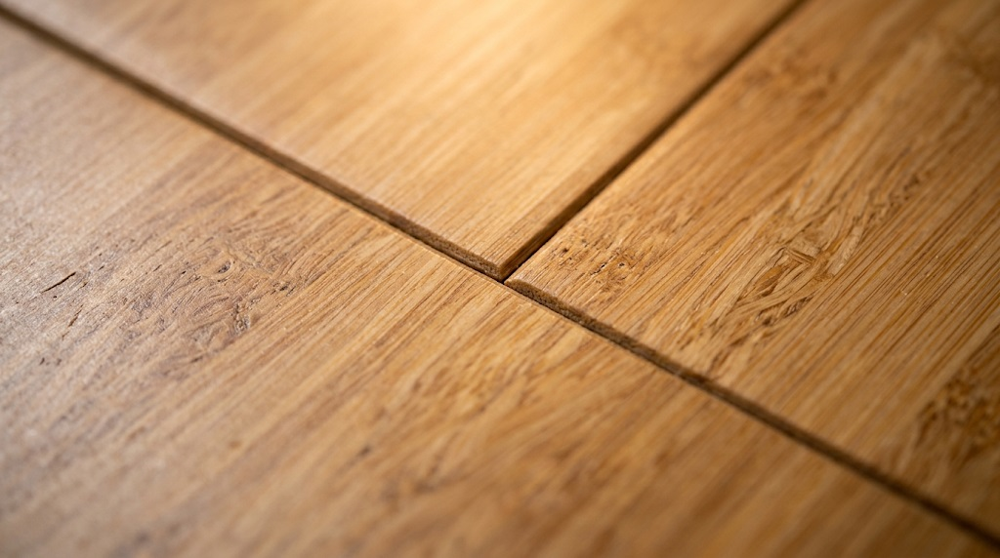
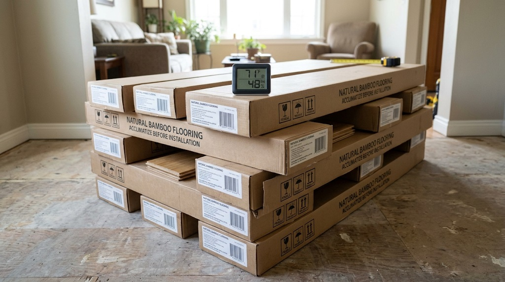
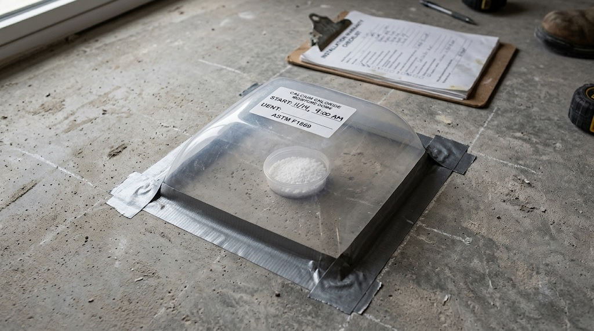

When you step into a flooring showroom, you are immediately bombarded with massive displays from industry giants. Brands like Shaw Floors and Mannington dominate the hard surface market, offering everything from luxury vinyl plank to premium engineered hardwood. But when it comes to their bamboo lines, the conversation shifts dramatically. Bamboo is a unique beast. It is a grass compressed into a highly durable floor covering, meaning it behaves differently than traditional oak, maple, or hickory. 

Buyers often assume that purchasing a bamboo floor from a massive, reputable brand guarantees a flawless experience. The reality is far more nuanced. Both Shaw and Mannington have offered various iterations of bamboo flooring over the years, testing different construction methods, core materials, and locking mechanisms. Knowing whether either brand's bamboo line is worth your investment requires looking past the glossy marketing brochures and directly into the milling quality, the core stability, and the extremely strict fine print of their warranties.

## Examining Shaw Floors Bamboo

Shaw Floors approaches the hard surface market with immense manufacturing power. Over the years, their bamboo strategy has frequently leaned heavily into engineered construction. Instead of offering solid bamboo planks, Shaw has often utilized a bamboo veneer layered over a high-density fiberboard (HDF) or a cross-ply plywood core.

This engineered approach is highly deliberate. Bamboo is naturally hygroscopic, meaning it absorbs and releases moisture readily, expanding and contracting with seasonal humidity changes. By gluing a bamboo wear layer to an engineered core, Shaw attempts to stabilize the plank and reduce the natural volatility of the raw material. 

### Where Shaw Excels

The primary advantage of Shaw’s engineered bamboo lines is dimensional stability. If you live in a region with distinct seasonal changes—where summers are humid and winters are bone-dry from indoor heating—an engineered core will resist cupping and crowning much better than solid horizontal or vertical bamboo. 

Additionally, Shaw utilizes advanced finishing techniques. Their factory-applied aluminum oxide finishes are cured under UV light, creating a wear layer that is highly resistant to micro-scratches from pet claws and shoe soles. For homeowners who want the exotic look of bamboo without the extreme climate sensitivity of solid planks, Shaw's engineered constructions provide a safer entry point. Their locking mechanisms are also highly engineered, allowing for floating installations that move as a single cohesive unit rather than fighting against individual plank expansion.

### Where Shaw Falls Short

The compromise with Shaw’s engineered bamboo is the thickness of the actual bamboo layer. Engineered planks feature a thin veneer of bamboo on top. Unlike solid hardwood or solid strand-woven bamboo, this thin top layer cannot be sanded down and refinished in the future. If a heavy object is dropped and deeply gouges the floor, or if years of heavy traffic wear through the aluminum oxide finish, the plank must be completely replaced. 

Furthermore, while the HDF core provides stability, it is still vulnerable to topical moisture. If a pet accident or a spilled glass of water is left unattended, the liquid can seep into the seams, causing the fiberboard core to swell irreversibly. 

## Examining Mannington Bamboo

Mannington has built a fiercely loyal following based on their aesthetic designs and proprietary finish technologies. When evaluating their bamboo options, buyers will often find a mix of engineered and solid strand-woven products, depending on the specific collection and retail year. Mannington heavily emphasizes the visual appeal, offering rich carbonized tones, subtle wire-brushed textures, and micro-beveled edges that closely mimic premium traditional hardwoods.

### The Mannington Advantage

Mannington’s true strength lies in its surface technology. Their premium hard surfaces often feature proprietary scratch-resistant topcoats that outperform standard polyurethane finishes. When they utilize strand-woven bamboo—a process where raw bamboo fibers are shredded, soaked in adhesives, and compressed under thousands of pounds of pressure—the resulting floor is incredibly dense. 

Strand-woven bamboo from Mannington can register significantly higher on the Janka hardness scale than domestic red oak or hickory. This makes it an excellent candidate for active households. The heavy compression process creates a floor that fiercely resists indentations from dropped pans, high heels, and heavy furniture legs. Mannington also tends to excel in their milling precision. Planks fit together tightly, minimizing the gaps where dirt, dust, and moisture typically gather.

### Limitations to Watch For

The extreme density of strand-woven bamboo is a double-edged sword. While it resists dents beautifully, it is highly reactive to moisture. Solid strand-woven bamboo acts like a dense sponge. If installed in an environment with high humidity, it will expand with tremendous force. We have seen solid bamboo floors expand so violently that they buckle upward or literally push drywall off the framing.

Mannington’s warranties for solid bamboo products reflect this reality, containing incredibly strict parameters for indoor humidity management. If your home lacks a central humidifier for dry winters or robust air conditioning for humid summers, maintaining the required environmental conditions will be a massive headache.

## The 3 Scenarios That Work

If you are committed to the aesthetic and eco-friendly appeal of bamboo from major manufacturers, you must align the product with the correct environment. Bamboo is not a universal flooring solution. It requires specific conditions to thrive. Here are the three applications where these bamboo lines actually perform beautifully over the long haul.

### Engineered Planks on Concrete

If you are installing flooring in a basement, a ground-level condo, or a home built on a concrete slab, engineered bamboo is the only logical choice. Concrete slabs constantly wick moisture from the earth. Solid bamboo placed near concrete will eventually absorb that vapor, leading to cupping and joint failure. Using an engineered bamboo line (like those often produced by Shaw) with a high-quality moisture barrier underlayment allows you to float the floor safely. The engineered core handles the slight vapor emissions much better than solid grass fibers.

### Strand Woven in Stable Climates

For homeowners living in regions with incredibly stable year-round climates—or those with high-end HVAC systems that maintain indoor humidity strictly between 40% and 60%—solid strand-woven bamboo is phenomenal. In these controlled environments, you can capitalize on the extreme durability of the strand-woven compression without worrying about expansion and contraction. In these specific settings, the floor will outlast traditional oak and maintain its smooth, dent-free appearance for decades.

### Solid Formats on Plywood

If you have a traditional wood subfloor (plywood or OSB) and live above grade, utilizing a nail-down installation with solid bamboo provides a permanent, professional feel. Nailing the floor directly into the wood subfloor via the tongue of the plank secures the floor firmly. When paired with the correct gauge of cleat or staple, this installation method minimizes hollow sounds when walking and provides a rock-solid foundation for active families. 

## The 5 Traps That Void Your Warranty

The flooring industry is notorious for strict warranty guidelines, and bamboo flooring carries some of the most aggressive fine print on the market. Many homeowners file claims for buckling, cupping, or finish peeling, only to have their claims immediately denied by the manufacturer due to installation errors. If you purchase bamboo from Shaw, Mannington, or any other brand, committing any of these five mistakes will instantly tear up your residential warranty.

### Skipping Subfloor Moisture Tests

This is the most common reason bamboo warranties are voided. Before a single plank is laid down, the installer must test the subfloor for moisture. For concrete, this means conducting calcium chloride tests or in-situ relative humidity probe tests. For wood subfloors, a pin-style moisture meter must be used to ensure the subfloor is dry and within a few percentage points of the bamboo's moisture content. 

If your floor fails six months down the line and you try to file a claim, the manufacturer's first question will be: "Send us the documented moisture readings from the day of installation." If you or your contractor skipped the test and have no documentation, the claim is instantly denied. 

### Ignoring Acclimation Protocols

Bamboo must adjust to the temperature and humidity of your home before it is installed. This process is called acclimation. You cannot buy bamboo flooring on a Tuesday, bring it home, and install it on Wednesday. 

The boxes must be brought into the installation room, opened, and cross-stacked to allow air to flow around the planks. The HVAC system must be running at normal living conditions. Depending on the brand's specific guidelines, this acclimation period must last anywhere from 72 hours to a full week. Some strand-woven bamboo lines require even longer because the material is so dense that it takes extended time to absorb or release moisture. Installing un-acclimated bamboo guarantees massive expansion or shrinkage within the first seasonal change.

### Installing Over Active Radiant Heat

Radiant heating systems installed beneath the floor are a luxury in cold climates, but they are the natural enemy of solid bamboo. The direct, concentrated heat bakes the moisture out of the planks from the bottom up. This rapid drying causes the bottom of the plank to shrink faster than the top, leading to extreme gapping, splitting, and cracking. While some engineered bamboo lines are rated for radiant heat, virtually all solid and strand-woven bamboo warranties expressly forbid installation over active radiant floor heating systems. 

### Skimping on Expansion Gaps

Bamboo moves. When the weather gets humid, the entire floor will swell and push outward toward the walls. To accommodate this, manufacturers require a specific expansion gap—usually between 3/8 inch and 1/2 inch—around the entire perimeter of the room, as well as around all fixed objects like kitchen islands, pipes, and door frames.

Inexperienced installers or DIY homeowners often push the flooring flush against the wall or leave a tiny 1/8 inch gap. When the summer humidity arrives, the floor expands, hits the drywall, and has nowhere left to go but up. The floor will buckle, creating massive bubbles in the middle of your living room. If an inspector finds that the expansion space was ignored, the manufacturer holds zero liability.

### Cleaning with Steam Mops

The marketing around steam mops is compelling, promising deep sanitation without harsh chemicals. However, using a steam mop on a bamboo floor is a direct violation of the warranty. Steam mops blast superheated water vapor directly into the seams of the flooring. 

Bamboo, regardless of the brand or finish quality, will absorb that pressurized vapor. Over time, the edges of the planks will begin to swell, creating a rough, raised texture across your entire floor known as micro-bevel swelling. Furthermore, the intense heat can compromise the adhesion of the aluminum oxide finish, causing it to haze or peel. The only approved cleaning method for these floors is dry dust mopping and lightly misting a pH-neutral hardwood floor cleaner onto a microfiber pad.

## Making Your Final Decision

Choosing between Shaw and Mannington for a bamboo floor ultimately comes down to understanding the environment of your home and the subfloor you are building upon. Both brands offer high-quality materials, but they are not magic solutions that bypass the laws of physics. 

If you need the stability of an engineered product to combat fluctuating humidity or concrete subfloors, look closely at the engineered options available. If you require the ultimate density to withstand a bustling household and can strictly control your indoor climate, a strand-woven option will serve you beautifully. Treat the installation manual as strict law, demand documented moisture testing from your contractors, and your bamboo floor will provide the elegance and longevity you expect.