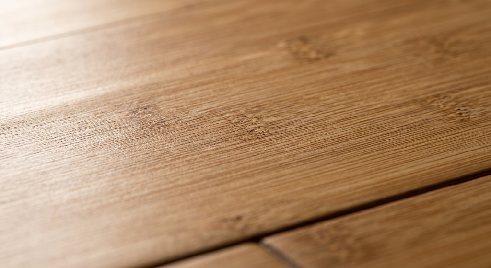
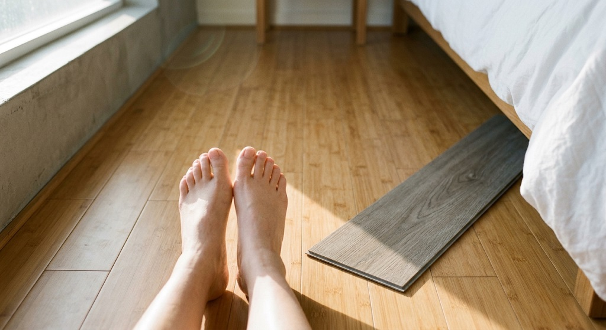
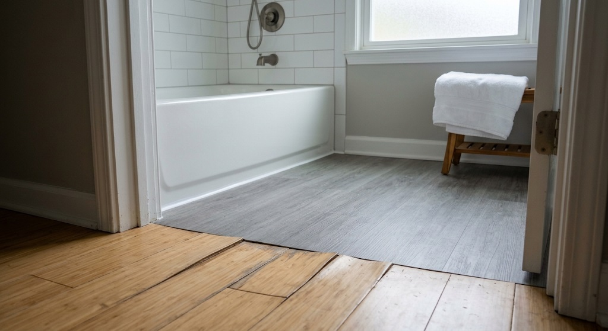
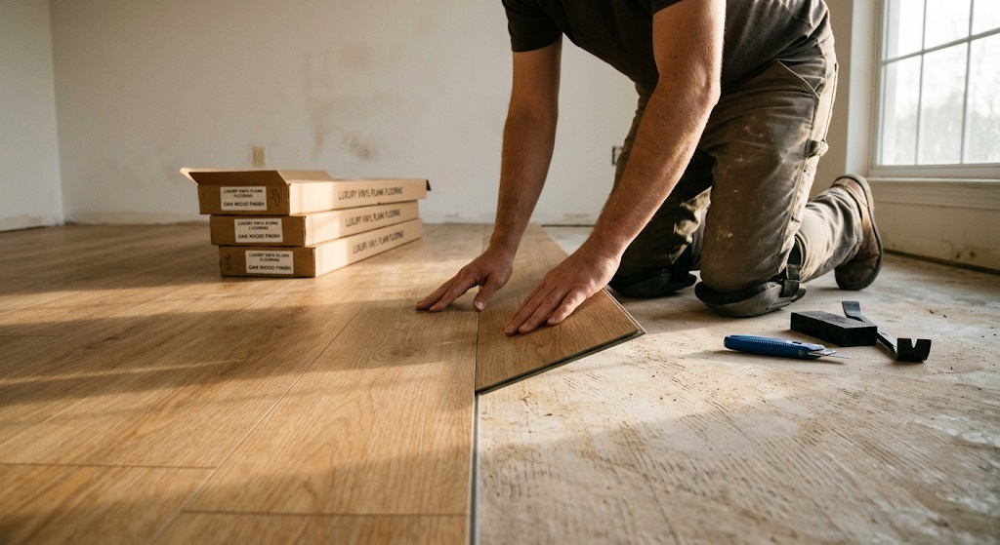
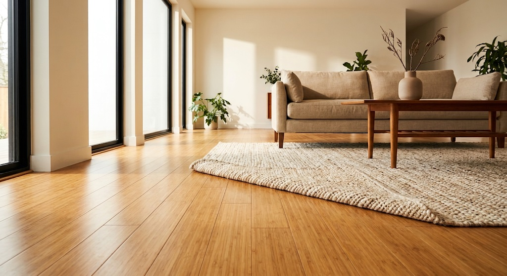

The honest answer comes first, because most of the confusion around this comparison is a matter of putting the right floor in the wrong room. Cali bamboo is the harder, more natural product that rewards a dry, stable space and holds its value over time. Cali vinyl is the waterproof, cheaper-to-install product that wins in basements, bathrooms, and rental properties. Spend more on bamboo in a damp basement and you are wasting money. Lay vinyl in a formal living room and you are leaving value on the table.

Cali Floors built its name on bamboo long before vinyl became the brand's best seller, so comparing the two is really a comparison of where the company started and where it is now.

## Two Different Products Under One Brand

Cali bamboo is a plant product. Cali vinyl is a manufactured composite. They share a logo, not a material, and that single fact drives almost every difference that follows.

### What Cali bamboo is

Cali's bamboo lines are built around fossilized bamboo, a strand woven board pressed under heat and pressure until it is denser than most hardwoods. The finished plank is hard, stable, and unmistakably organic, with the tight grain of compressed fibers rather than a printed surface that repeats every few boards.

### What Cali vinyl is

Cali vinyl is a rigid core plank, either stone polymer or wood polymer composite, topped with a printed film and a clear wear layer. The wood look comes from a photograph, not from wood. What the vinyl gives up in natural character it earns back in predictability, because the board does not react to water, temperature, or how often a mop runs over it.

## Hardness and the Price of Softness

Cali's fossilized bamboo carries a Janka hardness rating well above five thousand, which places it ahead of red oak and maple. Hardness decides how a floor takes abuse, and it cuts both ways.

### Where bamboo's hardness shows

A hard floor resists dents from furniture legs, appliance rollers, and dog nails. The trade-off is brittleness: a heavy, pointed object that would dent a softer floor can chip a hard one instead. Bamboo rewards a household that moves furniture with pads and accepts that a chip is usually there to stay, because not every bamboo floor can be sanded.

### Where vinyl gives ground

Vinyl's wear layer resists scratches well, but the core underneath is softer. A piano leg or a refrigerator can leave a permanent dent that the printed surface cannot hide. Vinyl is also easier to repair, since a damaged plank can be lifted and swapped, which is a genuine advantage bamboo does not share.

## Feel, Warmth, and Sound

Bamboo feels like a floor made of plants. It has real grain under your feet, a slight give at the joints, and it holds the room's temperature instead of feeling cold. Walking on it is quiet, with a dull footstep sound that settles into the space.

Vinyl feels like a finished surface. It sits slightly hollow over the subfloor, sounds a little firmer and brighter when a shoe comes down, and stays cooler in a cold room unless an underlayment softens it. None of this makes vinyl bad, but it is the difference people notice the first week after installation, long before any scratch appears.

### When bamboo wins the room

In a living space where people go barefoot and furniture stays put, bamboo is the warmer, more substantial choice. The natural surface and the quiet step are part of what a buyer perceives as quality the moment they walk in.

### When vinyl wins the room

In a kitchen, mudroom, or hallway that gets wet shoes and quick cleanups, vinyl's predictability matters more than its feel. You will not think about how it sounds underfoot when you are wiping up a spill without worrying about the seam.

## Water Is the Deciding Factor

This is where the two products split hardest, and where most buyers should actually make their decision.

### Bamboo and moisture

Bamboo is a grass, and it responds to humidity the way grass does. A bamboo floor in a bathroom, a laundry room, or a below-grade basement is a warranty risk. It needs time to acclimate before installation and a stable indoor humidity after, and standing water can make it cup, swell, or grow mold at the seams.

### Vinyl and water

Cali vinyl is sold as waterproof, and for a floating plank that is mostly true. Spills sit on the surface, the core does not swell, and a basement that takes on an inch of water will not ruin a properly installed vinyl floor. This is the single strongest reason vinyl outsells bamboo in any room where water is a real possibility.

## What Installation Actually Costs

The sticker price of the plank is only part of the story, and for bamboo the gap between plank price and installed price is the widest.

### Bamboo is a glue and nail job

Solid and engineered bamboo is generally nailed or glued down, which means professional labor, subfloor preparation, and time. The planks also have to sit in the room for days to acclimate before they go down. Labor pushes the installed cost well above the price printed on the box.

### Vinyl is a weekend job

Most Cali vinyl is click-lock and floating, and a competent homeowner can lay a room in a weekend over most existing floors. There is no glue, no nails, and no acclimation window. For a rental or a flip, that labor difference is often the entire decision.

## Where Your Money Goes Further

### In a dry, lived-in main floor, bamboo

A dining room, living room, or bedroom that stays dry and sees normal traffic is where bamboo earns its price back. It looks like the real thing because it is, it feels warmer underfoot than vinyl, and a well-made strand woven floor can outlast the vinyl by a wide margin.

### In a basement, bath, or rental, vinyl

Anywhere water is a genuine possibility, vinyl is the smarter spend. It costs less to buy, less to install, and it survives the flood that would finish a bamboo floor. For a property you rent out or plan to sell soon, vinyl's low install cost protects your margin.

## The Ten-Year View

### What bamboo costs to keep

Bamboo wants the humidity watched and the finish respected. Some floors can be screened and recoated, but not all bamboo can be sanded, so a deep scratch may be permanent. The upkeep is low, but it is not zero, and it rewards an owner who reads the care instructions.

### What vinyl costs to keep

Vinyl asks for almost nothing day to day. The trade-off arrives later, because a worn or dated vinyl floor is usually torn out and replaced rather than restored, and it cannot be refinished at all.

### Resale and perception

A natural bamboo floor reads as an upgrade to most buyers, because it is a real material that photographs well and feels substantial underfoot. Vinyl, even a good one, still reads as vinyl. In a market where buyers compare listings, bamboo adds a quiet edge in a main living area, while vinyl is simply expected in the utility spaces.

## Questions Buyers Ask Most

### Is Cali vinyl waterproof?

The plank itself is waterproof and safe for bathrooms and basements when installed as a floating floor. The subfloor underneath still needs to be dry and clean before the vinyl goes down.

### Is Cali bamboo harder than vinyl?

Yes, by a wide margin. Fossilized bamboo rates far harder on the Janka scale than any vinyl plank, which means fewer dents but a more brittle surface that can chip under a sharp blow.

### Can I install Cali bamboo myself?

It is possible with nail-down engineered boards, but most people hire it out. The acclimation window and subfloor prep make it a slower, more demanding job than floating vinyl.

### Which holds resale value better?

Bamboo, in a dry main living area. Vinyl is expected in utility rooms and rarely adds much beyond being new and clean.

The choice is not about which floor is better, because they are better at different things. Put bamboo where people live and the air stays dry, and it will look and feel better for longer. Put vinyl where the water is, and your money will go further with far less worry. Buy them the wrong way around and you pay twice.
