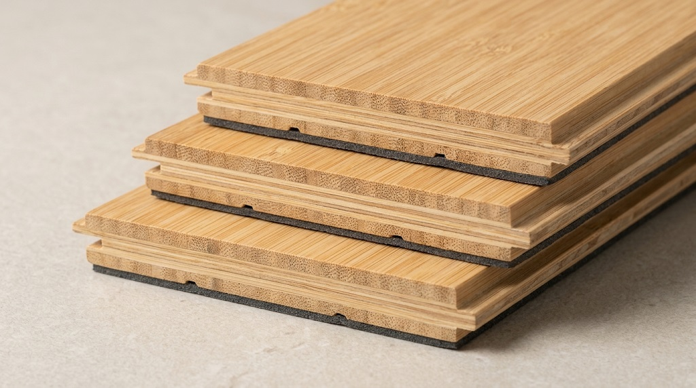
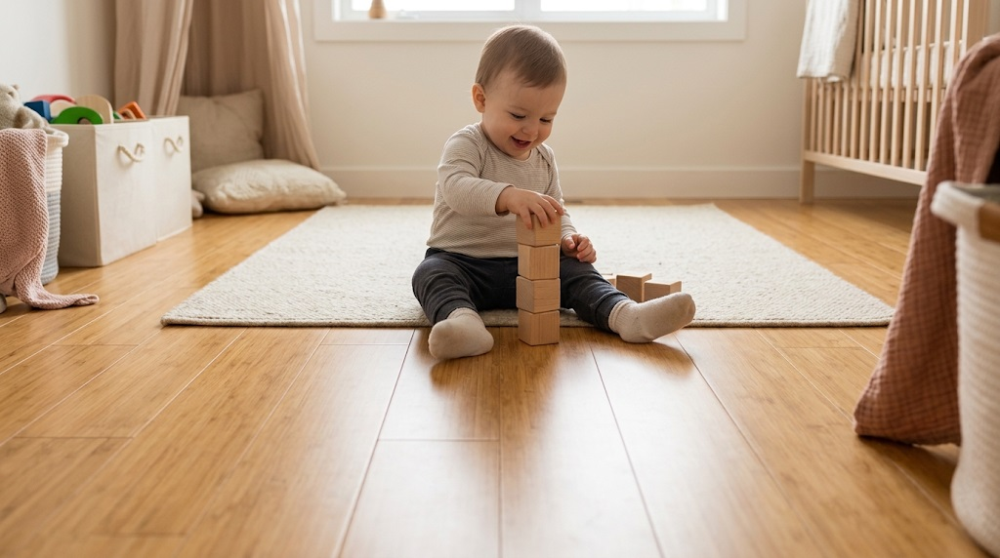

High-quality bamboo flooring is completely safe for kids, provided you choose boards verified by strict third-party indoor air quality standards like FloorScore or GREENGUARD Gold. While responsibly manufactured bamboo planks emit virtually zero harmful chemicals once installed, budget boards bonded with cheap urea-formaldehyde glues can release irritating gases into your nursery or playroom for months.

Parents spend hours researching non-toxic crib mattresses and BPA-free bottles, yet the largest surface in a child's bedroom often gets overlooked. Babies crawl with their hands and faces mere inches above the floorboards, and young children breathe more air per pound of body weight than adults. Understanding how bamboo planks are glued together, what regulatory labels actually guarantee, and how installation methods affect indoor air makes all the difference when choosing floors for a family home.

## Decoding Formaldehyde in Bamboo Flooring

Bamboo is not a hardwood tree; it is a fast-growing woody grass with a hollow stalk. To turn raw bamboo stalks into flat, structural floorboards, manufacturers slice the culms into thin strips or shred them into fibers, dry them, and bond them together under intense heat and hydraulic pressure. Because adhesives are essential to every bamboo plank on the market, the chemical makeup of that glue determines whether a floor is healthy for children.

Formaldehyde is a colorless, strong-smelling gas used in many industrial resins. Trace amounts occur naturally in wood, trees, and even human metabolism, so "formaldehyde-free" in the flooring industry usually means no added formaldehyde resins were used during manufacturing. Exposure to elevated levels of formaldehyde gas indoors can trigger watery eyes, scratchy throats, headaches, and asthma flare-ups in sensitive kids.

Flooring factories rely on three primary categories of binding resins:

* **Urea-Formaldehyde (UF) Resins:** Inexpensive and fast-curing, UF glues were historically common in low-cost imported flooring. However, UF bonds break down gradually when exposed to indoor heat and humidity, causing ongoing formaldehyde off-gassing long after the boxes are opened.
* **Phenol-Formaldehyde (PF) Resins:** Commonly used in exterior-grade structural panels, PF adhesives form much tighter chemical bonds than urea-formaldehyde. Once cured under factory heat, PF resins release dramatically lower gas emissions.
* **No-Added-Formaldehyde (NAF) and MDI Resins:** Premium bamboo manufacturers use methylene diphenyl diisocyanate (MDI) or soy-based bio-resins that contain zero added formaldehyde. These adhesives create waterproof structural bonds while keeping chemical emissions near background outdoor levels.

### Solid vs. Strand-Woven Glue Loads

Traditional horizontal and vertical bamboo planks glue flat strips side by side, requiring relatively modest amounts of adhesive. Strand-woven bamboo shreds the grass fibers and compresses them with resin at roughly twice the density of oak. Because strand-woven planks use a higher ratio of resin by volume, verifying that the manufacturer uses NAF or ultra-low-emitting PF adhesives is especially important.

### Engineered Bamboo Core Risks

Engineered bamboo features a real bamboo wear layer bonded over a multi-ply eucalyptus, birch, or high-density fiberboard (HDF) core. Even if the top bamboo veneer uses clean glue, a low-grade plywood or HDF core underneath can still off-gas formaldehyde if the factory cuts corners on internal layers.

## Solving the CARB Phase 2 and EPA TSCA Title VI Puzzle

Shopping for kid-safe flooring quickly turns into alphabet soup when you flip over a sample box. You will almost always see stamps reading "CARB Phase 2 Compliant" or "EPA TSCA Title VI Compliant." Knowing what these rules cover—and what they miss—keeps you from relying on incomplete safety claims.

The California Air Resources Board (CARB) established strict limits on formaldehyde emissions from composite wood products sold in California, and the U.S. Environmental Protection Agency later adopted those identical thresholds nationwide under TSCA Title VI. Under these federal rules, hardwood plywood cores cannot emit more than 0.05 parts per million (ppm) of formaldehyde in chamber testing, while particleboard is capped at 0.09 ppm and medium-density fiberboard at 0.11 ppm.

Here is the regulatory puzzle many parents miss: CARB Phase 2 and EPA TSCA Title VI legally apply to composite wood panels such as hardwood plywood, particleboard, and MDF. While engineered bamboo built on a plywood or HDF core falls directly under these mandatory rules, solid strip bamboo sometimes sits in a regulatory gray area depending on how the strips are laminated. Furthermore, CARB Phase 2 only measures formaldehyde—it does not test for hundreds of other volatile organic compounds found in stains, sealers, or installation glues.

## Beyond Formaldehyde: VOCs, Finishes, and Installation Glues

Volatile organic compounds (VOCs) encompass a wide family of carbon-based chemicals that evaporate into room air at normal household temperatures. In flooring, VOCs come from dark chemical stains, surface lacquers, plasticizers, and the wet adhesives used to glue planks to a concrete or wood subfloor.

Fortunately, most reputable prefinished bamboo floors use factory-applied, UV-cured aluminum oxide polyurethane finishes. During production, liquid urethane coatings pass beneath high-intensity ultraviolet lamps that harden the finish instantaneously. Because the chemical curing reaction finishes inside the factory before the planks are boxed, UV-cured aluminum oxide surfaces emit virtually no VOCs once they reach your home.

The bigger hidden source of indoor air pollution during a flooring project is installation adhesive. Traditional glue-down installations require spreading buckets of trowel-down urethane or polymer adhesive across the entire subfloor. Even low-VOC wet adhesives release noticeable odors during curing and require days of heavy ventilation before babies or toddlers should sleep in the room. Choosing a floating click-lock bamboo plank locks boards together mechanically over a dry foam or cork underlayment, eliminating wet floor glues completely.

### FloorScore and GREENGUARD Gold

To look past marketing buzzwords, check for FloorScore or GREENGUARD Gold certification on the exact product line you plan to buy. Both programs test finished flooring products against the California Department of Public Health (CDPH) Standard Method v1.2, which models chemical exposure inside school classrooms populated by children. Under this strict benchmark, formaldehyde emissions must stay at or below 9 micrograms per cubic meter (roughly 0.0073 ppm)—nearly seven times stricter than CARB Phase 2 limits—while screening for dozens of individual VOCs.

### Choosing Low-VOC Underlayments

If you select a floating click-lock floor, pair it with a GREENGUARD Gold certified acoustic underlayment made from closed-cell polyethylene foam, natural cork, or recycled rubber. Cheap recycled-foam pads can carry chemical odors of their own even when the bamboo planks above them are spotless.

## Physical Safety for Crawling Babies and Active Toddlers

Chemical safety is only half the story when children share a room with new floors. Day-to-day physical durability, traction, and impact comfort matter just as much once kids start rolling, crawling, and sprinting through the hallway.

Strand-woven bamboo ranks between 3,000 and 4,000 pounds-force on the Janka hardness scale, making it more than twice as hard as traditional red oak at 1,290 pounds-force. That extreme density stops heavy wooden blocks, metal toy trucks, and dropped sippy cups from gouging the surface. Unlike softer pine or budget engineered wood that can peel or splinter along worn edges, dense strand-woven planks stay smooth against bare knees and hands for decades.

That same rock-solid density does mean bamboo feels firm underfoot when a nine-month-old loses balance while learning to stand. Placing a thick, low-pile cotton or wool area rug anchored by a natural rubber non-slip pad in primary play areas cushions tumbles while leaving the surrounding walkways easy to sweep.

Surface sheen also affects kid safety. High-gloss bamboo finishes look sleek in showrooms, but they become slippery for toddlers wearing cotton socks and highlight every tiny scuff mark. Choosing a matte, satin, or gently wire-brushed finish improves underfoot grip and camouflages everyday toy scratches. Additionally, while bamboo handles normal juice spills and damp mopping easily when wiped up promptly, standing puddles from overflowing bathwater or potty-training accidents should always be dried right away to prevent edge swelling.

## Step-by-Step Buyer Checklist for Parents

Before ordering pallets of flooring for a nursery, bedroom, or family play space, run through this practical verification checklist:

* **Verify Third-Party Certificates Online:** Do not settle for generic "eco-friendly" logos on a retailer's website. Ask for the current FloorScore or GREENGUARD Gold certificate number and verify that the specific collection name appears in the public SCS Global or UL Spot database.
* **Confirm NAF or CARB Phase 2 Core Specs:** If buying engineered bamboo, confirm in writing that both the bamboo wear layer and the underlying plywood or HDF core meet EPA TSCA Title VI and CARB Phase 2 rules, ideally utilizing No-Added-Formaldehyde adhesives.
* **Inspect and Smell Physical Samples:** Order two or three sample planks and place them inside a sealed zip-top bag in a warm sunny window for 24 hours. When you open the bag, you should smell faint natural woody fiber—never a sharp, acrid, or sweet chemical odor.
* **Prioritize Click-Lock Floating Profiles:** Select thick, precision-milled click-lock planks that install without wet subfloor adhesives whenever your subfloor flatness allows it.
* **Acclimate and Ventilate Before Move-In:** Stack open boxes in the installation room for 48 to 72 hours prior to installation so the bamboo adjusts to your home's indoor humidity, then run exhaust fans or crack windows for a couple of days afterward so dust and trace packaging odors clear completely.

## Frequently Asked Questions About Kid-Safe Bamboo Floors

### Does New Bamboo Flooring Smell?

Certified low-VOC bamboo flooring has only a mild, natural toasted-grass or woody scent when first unboxed, which fades within a few days of normal room ventilation. A sharp chemical smell that stings your eyes or nose indicates high residual solvents or unstable urea-formaldehyde resins and should never be installed in a child's bedroom.

### Is Bamboo Safer Than Vinyl Plank?

Solid and engineered bamboo floors made with NAF glues avoid the polyvinyl chloride (PVC), ortho-phthalates, and synthetic plasticizers found in traditional vinyl plank flooring. While GREENGUARD Gold certified rigid-core vinyl is also safe for indoor air, natural bamboo offers a plant-based surface free of chlorinated plastics.

### How Long Should New Floors Air Out?

With click-lock bamboo carrying FloorScore or GREENGUARD Gold certification, families can typically walk on the floor immediately after installation and let children sleep in the room after 24 to 48 hours of fresh air circulation. If trowel-down subfloor glue was used, allow at least 72 hours of continuous ventilation before moving cribs or beds back inside.

Creating a healthy floor for growing kids comes down to verifying the invisible chemistry inside the plank rather than trusting surface appearances alone. By pairing FloorScore or GREENGUARD Gold certified bamboo with a glue-free click-lock installation and a few well-placed play rugs, you get a durable, easy-to-clean surface that keeps your home's air fresh for years of childhood adventures.