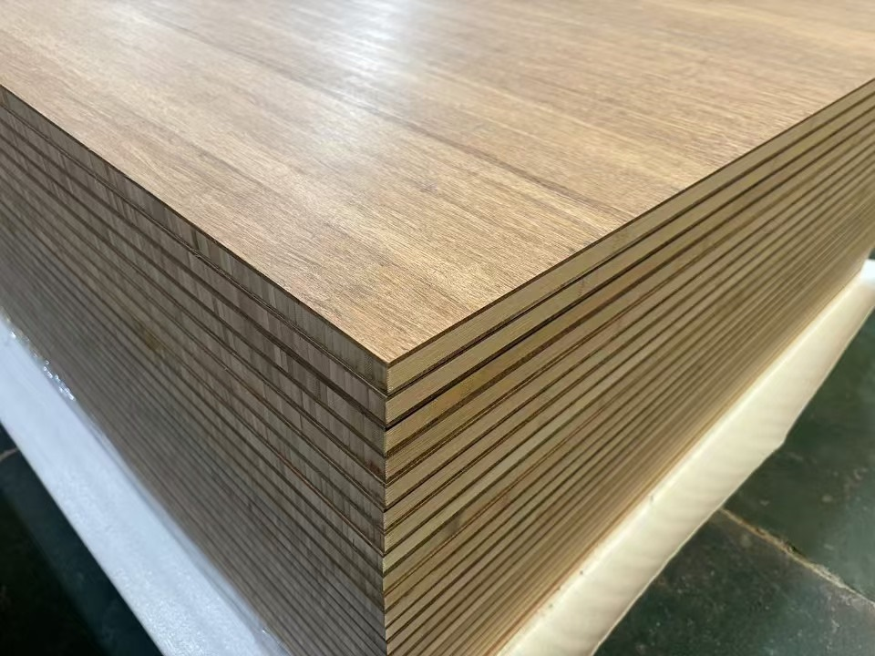
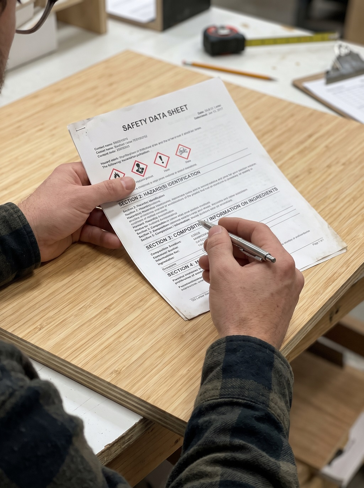
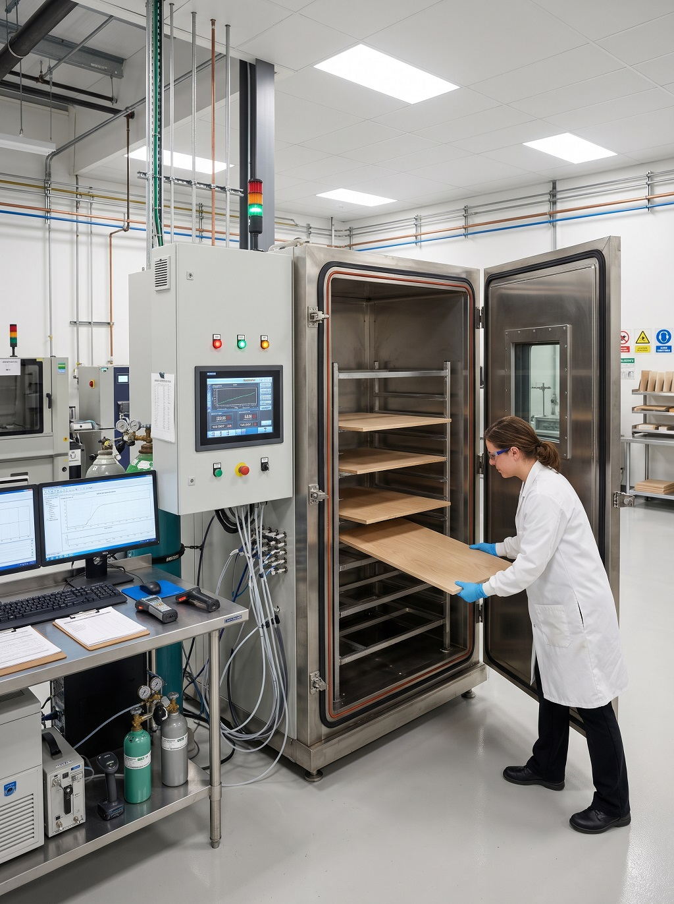

Architectural bamboo plywood has gained immense traction among builders, millworkers, and architects looking for high-density, visually appealing sheet goods. The raw grass provides the aesthetic and the strength, but the raw material alone cannot form a rigid panel. Manufacturers must bind thousands of precision-milled bamboo strips together using heavy-duty industrial adhesives. For anyone specifying or actively cutting Plyboo panels, the chemical makeup of these adhesives is a critical factor that directly impacts both worker safety and indoor air quality. 

The focus of environmental scrutiny usually falls on urea-formaldehyde, a thermosetting resin that has been a staple in the engineered wood industry for decades. Rather than relying on marketing brochures or generalized environmental claims, the most accurate way to understand the risks and physical realities of this chemical is by examining the product's official Safety Data Sheet. These federally mandated documents provide an unfiltered look at what goes into the panel, how the chemicals behave over time, and what specific precautions are necessary during fabrication.

## The Role of Adhesives in Bamboo Panels

To understand why urea-formaldehyde appears on safety documents, it helps to understand panel construction. Bamboo stalks are hollow and cylindrical. To make flat sheets, the stalks are sliced into thin, rectangular strips. These strips are boiled to remove sugars, kiln-dried, and then coated with adhesive before being subjected to massive hydraulic pressure and high heat. 

The adhesive must be capable of forming a bond stronger than the bamboo fibers themselves, while also resisting moisture and temperature fluctuations. Urea-formaldehyde has historically been the go-to choice because it cures rapidly under heat, creates a rigid cross-linked bond, and is highly cost-effective for large-scale manufacturing. 

When the panel is pressed, a chemical reaction takes place. The urea and the formaldehyde cross-link to form a solid plastic-like polymer. Once cured, the resin itself is largely inert. The primary concern outlined in safety documentation does not stem from the solid polymer, but rather from unreacted formaldehyde—residual chemical that did not successfully bond during the pressing process. This unreacted portion can slowly release into the surrounding air as a volatile organic compound.

### Resin Curing Mechanics

During the manufacturing phase, strict parameters dictate the heat and pressure applied to the panel. Optimal curing consumes the vast majority of the free formaldehyde. If the factory lines run too fast or the temperature is slightly off, the ratio of unreacted chemicals increases. This is why consistent quality control is heavily emphasized by premium brands like Plyboo, ensuring the chemical reaction reaches maximum completion before the panel ever leaves the factory floor.

## Navigating the Safety Data Sheet

A Safety Data Sheet is legally required for chemical products and composite wood products, designed primarily for workers handling the materials. Reading these documents requires filtering out the noise to focus on the sections detailing composition, hazards, and handling.

In Section 3, which covers composition and information on ingredients, you will find the exact percentage by weight of the adhesives used. Bamboo fiber typically makes up the vast majority of the panel's weight, with the resin accounting for a small single-digit percentage. If urea-formaldehyde is present, it will be listed here. 

However, the presence of the resin in the composition section does not translate directly to the emission rate. The SDS lists what is physically inside the board. It does not necessarily state how much is coming out of the board. For emission rates, users must look toward the regulatory certifications referenced elsewhere in the document or on the manufacturer's technical specifications.

### Hazard Identification

Section 2 of the SDS highlights the hazard identification. For standard bamboo panels containing urea-formaldehyde, the primary hazards listed are respiratory irritation, skin sensitization, and the potential for long-term health risks associated with formaldehyde exposure. The document treats the panel as a solid object that is generally safe under ambient conditions, but distinctly flags the risks when the panel is subjected to mechanical action—specifically sawing, sanding, or routing.

### Toxicological Information

Section 11 delves into toxicological data. Here, the document addresses the specific nature of formaldehyde gas. It is documented as a known human carcinogen and a severe respiratory irritant. The critical takeaway from this section is the concept of threshold limits. The human body can process and eliminate trace amounts of naturally occurring formaldehyde—which is found in apples, human breath, and untreated wood. The toxicological risks arise when ambient concentrations exceed specific parts-per-million thresholds in enclosed, poorly ventilated spaces.

## Regulatory Standards and Real Emissions

Because the Safety Data Sheet outlines potential hazards, regulatory bodies have stepped in to ensure that the actual emissions from finished panels remain well below harmful levels. The most stringent and widely recognized standards in North America are the California Air Resources Board Phase II standard and the federal EPA TSCA Title VI regulation. 

When an SDS or product spec sheet notes compliance with these standards, it means the product has been subjected to rigorous environmental chamber testing. During this testing, a sample of the bamboo panel is placed inside a sealed chamber with controlled temperature and humidity. The air is then continuously sampled to measure the exact amount of formaldehyde escaping from the board. 

To pass, standard composite panels must emit less than 0.05 parts per million of formaldehyde. Products that use urea-formaldehyde can absolutely meet these strict standards if the manufacturing process is dialed in correctly. Plyboo products typically carry these certifications, meaning that while the chemical may be listed on the SDS, the actual off-gassing rate has been legally verified to be extremely low.

### The ULEF Designation

Many premium panels achieve a classification known as Ultra-Low Emitting Formaldehyde. This indicates that while formaldehyde-based resins are used, the emissions are consistently so far below the regulatory limits that the manufacturer is granted reduced testing frequencies. Seeing a ULEF designation alongside an SDS that lists urea-formaldehyde is an indicator of highly efficient curing processes.

## Handling and Millwork Precautions

The most critical information contained in the Safety Data Sheet applies to the people actually building with the material. When a finished bamboo panel sits in a living room, its emissions are minimal. When that same panel is pushed through a table saw, the situation changes entirely.

Mechanical cutting generates fine bamboo dust. Wood dust itself is a recognized respiratory hazard, but when combined with cured urea-formaldehyde resin, the risk increases. The friction and heat generated by saw blades and router bits can cause localized thermal breakdown of the adhesive. This momentary heating can release trapped pockets of gas right at the cut line, exposing the operator to a sudden, concentrated dose of both particulate matter and volatile compounds.

Section 8 of the SDS focuses heavily on Exposure Controls and Personal Protection. It mandates the use of active dust collection systems at the source of the cut. A standard shop vac is often insufficient; high-volume dust extraction equipped with fine-particulate filters is required to keep the air safe. Additionally, operators are advised to wear NIOSH-approved respirators rather than basic paper masks, ensuring that the ultrafine resin-coated dust does not enter the lungs.

### Ventilation Requirements

Beyond point-of-source dust collection, the SDS emphasizes general ambient ventilation. Millwork shops processing large volumes of composite panels must cycle their indoor air frequently. Allowing dust and trace gases to accumulate in a stagnant shop environment over an eight-hour shift will quickly exceed the permissible exposure limits outlined by occupational safety organizations.

## Indoor Air Quality and Off-Gassing Timeline

For architects and homeowners, the primary concern is what happens after the material is installed. The off-gassing of urea-formaldehyde follows a specific decay curve. When a panel is first pressed, it has a certain chemical load. Over the first several weeks of its life—often while sitting in a warehouse or on a shipping container—the emission rate drops steeply. 

By the time Plyboo panels arrive at a job site, the highest period of off-gassing has already passed. However, environmental factors on the job site can temporarily alter the emission rate. Formaldehyde is highly reactive to heat and moisture. If bamboo flooring or wall cladding is installed in a space with high humidity and elevated temperatures, the remaining unreacted chemicals will off-gas at an accelerated rate. Conversely, in a cool, dry, well-ventilated space, emissions slow down dramatically.

Proper site acclimation is crucial. Installers should unbox the panels and allow them to rest in the installation environment while the HVAC system is running. This not only allows the bamboo to reach structural equilibrium with the room's moisture content, preventing warping, but it also allows the building's ventilation system to capture and exhaust any residual off-gassing before the space is occupied.

## Specifying the Right Panel for the Project

When reviewing the Safety Data Sheets, buyers will notice that many manufacturers, including Plyboo, offer alternative adhesive formulations. Driven by green building standards like LEED, the market has expanded to include products manufactured with No Added Formaldehyde adhesives, typically utilizing soy-based or specialized polyurethane binders. 

If a project requires absolute minimization of chemical emissions—such as in healthcare facilities, schools, or homes for chemically sensitive individuals—specifying an NAF board eliminates urea-formaldehyde from the equation entirely. The Safety Data Sheet for an NAF product will show a completely different chemical profile in Section 3, replacing the formaldehyde warnings with information relevant to the alternative binders.

However, for standard commercial and residential applications, panels utilizing advanced, low-emission urea-formaldehyde remain a highly viable and safe option, provided they carry the necessary CARB Phase II or TSCA Title VI certifications. The key to working safely with these materials lies in respecting the data. By understanding the distinction between the solid cured resin and the unreacted volatile compounds, maintaining rigorous dust control during fabrication, and managing job site climate control, builders can utilize the strength and beauty of architectural bamboo while fully mitigating the chemical risks outlined in the safety documentation.