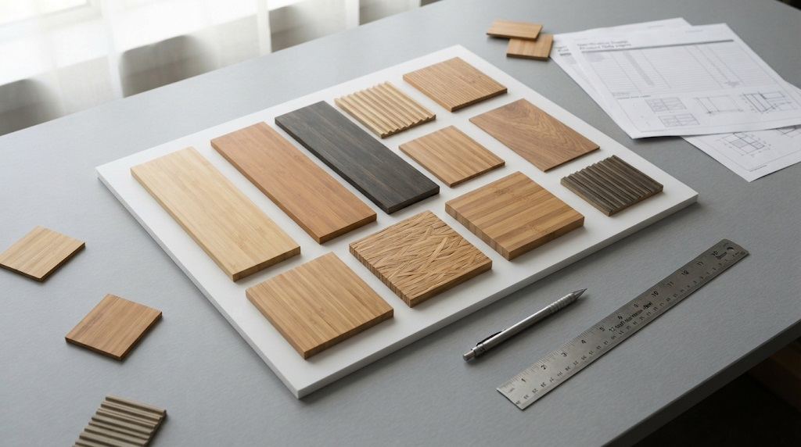
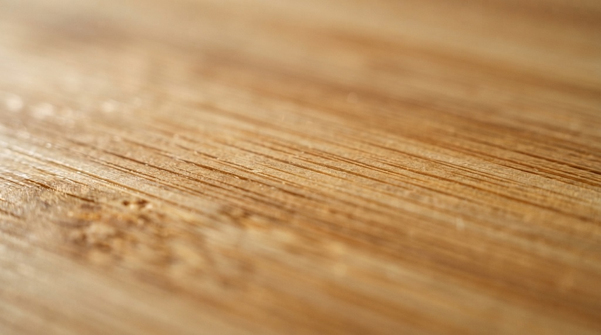
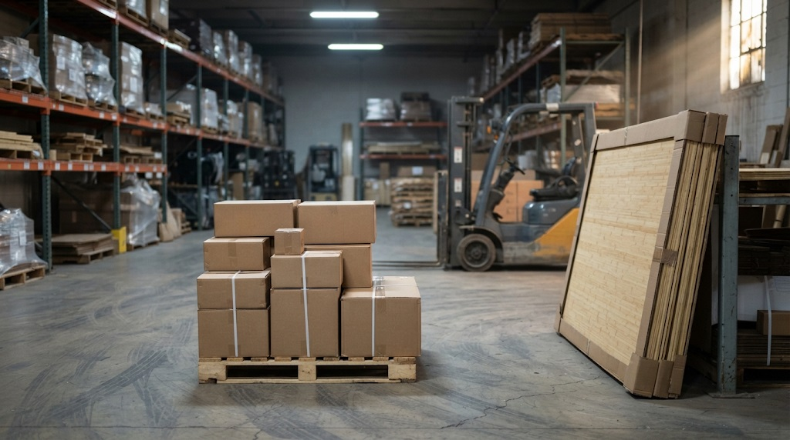
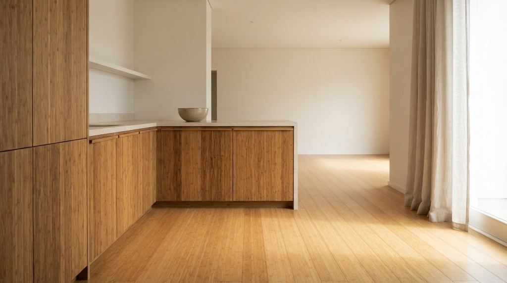

Both brands sell strand woven bamboo at prices that start where the box store options end, and both are named in almost every serious conversation about the material. The difference is where each one came from.

Plyboo grew out of architectural panels. The brand was built to supply designers and fabricators with bamboo sheet goods, and flooring came along as a natural extension of that work. Teragren grew out of flooring. The company was founded to make a residential floor that could compete with hardwood on durability rather than novelty, and panels followed later.

That origin story still shapes what each brand is good at. Choose Plyboo when the project involves millwork, matching panels, or a designer who specifies by sample. Choose Teragren when the job is a floor and the questions are about wear, warranty, and indoor air quality.

## How the Two Brands Got Here

### Plyboo and the panel trade

Plyboo is a Smith and Fong brand, and the company started in San Francisco working with bamboo as a sheet material for furniture and interior architecture. The name itself is a compression of plywood and bamboo, which tells you what the founders thought they were making.

That heritage shows in the catalog. Plyboo offers flooring, but it also offers panels, veneer, and textured surfaces for wall cladding and cabinetry, in a range of grains and tones that architects can specify by name. A designer working on a restaurant or a reception desk can pull the floor and the wall finish from the same sample chain, which is a real advantage when a project needs to look deliberate.

### Teragren and the floor trade

Teragren was founded on Bainbridge Island in Washington by a group that wanted to prove bamboo could hold up in an American house. The early work was on strand woven construction, pressing bamboo fiber into a board dense enough to survive dogs, kids, and a decade of dinner parties.

The result is a catalog built around floors first. Teragren's lines are organized by how they wear and what they cost, with matching stair nosings, reducers, and trim available as part of the system. If you have ever tried to find a transition strip that matches a discontinued floor, you understand why that matters.

## Construction and Density

Both brands build their premium floors from strand woven bamboo, which means both start from shredded fiber pressed with resin into a dense block. The result is the same category of product, far harder than a horizontal or vertical plank.

### What strand woven actually buys you

Density in a good strand woven board lands above 1000 kilograms per cubic meter, against roughly 650 for horizontal bamboo. On the Janka scale, strand woven bamboo frequently tests in the low thousands, well past red oak at around 1290. Practically, that means fewer dents from chair legs and a floor that tolerates a real household.

Both brands are also honest about the material's weakness. Bamboo is dense and hard, and hard surfaces chip rather than dent when something sharp lands on them. Neither brand sells a floor that survives a dropped cast iron pan without a mark.

### Where the two diverge

Plyboo leans toward architectural expression. Its strand lines include wider planks, deeper textures, and finishes intended to read as a design decision. Teragren leans toward uniformity, with tighter color consistency across a run so that a large open floor does not show the batch variation that natural bamboo is prone to.

If your concern is that the floor matches the sample, Teragren is usually the calmer choice. If your concern is that the floor looks like nothing else in the neighborhood, Plyboo has more to work with.

## Finish and Surface

Both brands use factory-applied UV-cured finishes with aluminum oxide for abrasion resistance, which is the standard approach for a floor expected to last decades. The differences are in sheen and texture rather than chemistry.

Plyboo offers more surface variety, including wire-brushed and lightly textured options that break up the uniformity of strand woven. Teragren tends toward a narrower range of sheens, mostly satin and matte, on the theory that a floor should not compete with the furniture.

A practical note on sheen: a high-gloss strand woven floor shows every footprint and dust particle within a day of cleaning. Satin hides more and photographs better in a listing. This is true of both brands, and it is the single most common regret among buyers who chose gloss.

## Adhesives and Indoor Air

This is the question buyers ask most, and it deserves a direct answer. Bamboo flooring is glued, whether the binder is in the strand woven block or between the layers of an engineered plank, and the adhesive is where formaldehyde concerns originate.

Teragren built much of its reputation on this point, marketing floors made with a formaldehyde-free binder and publishing indoor air quality documentation for its lines. Plyboo, coming from the panel world, has had to meet the stricter panel standards that govern sheet goods, which in the United States means CARB Phase 2 and TSCA Title VI compliance.

Both approaches can produce a safe floor. What matters is that you ask for the specific documentation for the specific product, not the brand's general position. A floor can be compliant and still smell of resin for a week, and a floor can be low-emitting and still be damaged by a spilled bucket. Get the sheet, read the number, and keep the room ventilated during installation.

## Price, Lead Time, and Availability

Premium strand woven bamboo generally runs somewhere between six and twelve dollars per square foot for the material, before installation. Both brands sit in the upper part of that range, and both command a premium over the imported strand woven sold under house labels.

### What drives the gap

Part of the price is the brand, part is the specification work, and part is the trim. A floor that comes with matching stair parts and a warranty that a dealer will actually honor costs more than a stack of cartons with a phone number on the side.

Lead time is the other variable. Architectural panel orders through Plyboo can run weeks, because panels are often made to a project specification. Teragren flooring is more likely to be in stock at a distributor, which matters when a renovation has a deadline.

### A word on the catalog

Both companies have changed ownership and trimmed product lines over the years, and the bamboo market has consolidated. Before you fall in love with a specific color, confirm with a dealer that the line is currently produced, and ask whether the matching trim is available in the same run. Buying a discontinued floor at a discount is fine until you need a stair nosing.

## Which Brand Fits Which Project

### Choose Plyboo for millwork and design

A kitchen with bamboo cabinetry and a matching floor, a retail interior with cladding, a stair with a bamboo stringer: Plyboo's strength is the whole surface palette, not just the plank.

### Choose Teragren for floors only

A house, a condo, a rental you intend to keep: Teragren's focus on flooring, trim, and documentation makes it the simpler specification when the floor is the entire scope.

### Choose neither if the room is wet

Neither brand solves water. A bathroom or a basement needs a waterproof floor, and no amount of density changes how bamboo responds to standing moisture. This is where a rigid vinyl plank wins on merit, not on price.

## Questions Buyers Ask Most

### Is Plyboo better than Teragren?

Neither is better in the abstract. Plyboo has the broader surface range for architectural work, and Teragren has the tighter flooring system with matching trim and a longer track record in residential floors.

### Are both formaldehyde-free?

Teragren markets formaldehyde-free binders on its flooring lines. Plyboo meets the panel emission standards that apply to sheet goods. Ask for the product-specific documentation rather than relying on either brand's general claim.

### Can these floors be refinished?

Strand woven bamboo from either brand usually allows one or two sandings over its life, depending on the wear layer and how much material the first pass removes. Confirm the number with the manufacturer before you hire a sander.

### Why the premium over imports?

Brand specification, matched trim, dealer support, and warranty administration. The bamboo itself may come from the same growing region in Zhejiang, but the system around it does not.

The two names look like competitors on a spec sheet and behave like different tools in practice. One is built to be specified alongside panels and veneer, the other is built to be lived on and replaced part by part if it ever comes to that. Know which problem you are solving, and the choice stops being difficult.
