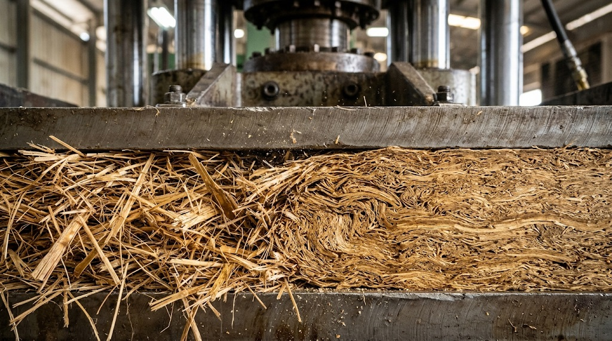
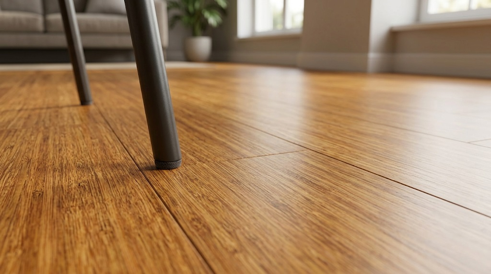
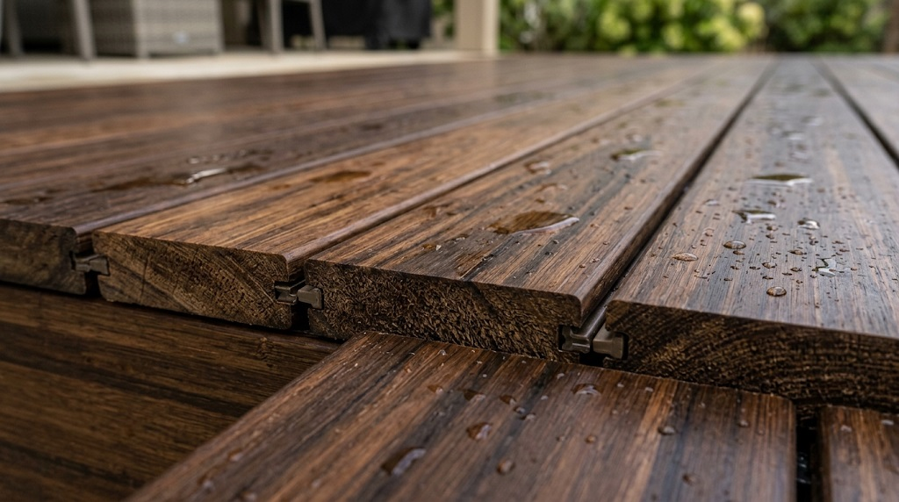

When specifying high-density architectural materials, strand woven bamboo consistently outperforms traditional domestic hardwoods in raw physical metrics. The processing technology behind this material crushes natural bamboo culms into individual fibrous strands, saturates them with low-VOC adhesives, and binds them under immense hydraulic pressure. The resulting composite material boasts exceptional dimensional stability, sheer density, and extreme impact resistance. 

Two prominent brands have established heavy footprints in this sector: Cali Floors and Dasso. While both leverage strand woven technology, they engineer their products for vastly different environments. Cali Floors dominates the residential and light commercial interior flooring market. Dasso engineers its products primarily for harsh exterior applications, including decking, siding, and soffits. Understanding the structural differences, manufacturing nuances, and material limitations of each brand is critical for procurement managers, builders, and homeowners looking to specify the correct flooring or decking material for their projects.

## Understanding Strand Woven Technology

The fundamental advantage of strand woven bamboo lies in its engineered density. Traditional horizontal or vertical bamboo flooring retains the natural tubular structure of the plant, simply gluing machined strips together. Strand woven processing completely deconstructs the raw material to build something much stronger.

### The Compression Process

The manufacturing process begins by harvesting mature Moso bamboo, typically aged five to seven years to ensure optimal fiber strength. The hollow culms are split and shredded into long, continuous strands. These strands are then boiled to remove natural sugars and starches, a critical step that prevents future biological degradation and insect infestation. 

Once dried, the fibers are immersed in phenolic or polyurethane-based resins. The saturated strands are placed into massive molds and subjected to thousands of tons of hydraulic pressure. This cold-press or hot-press compaction creates a solid billet of bamboo composite. The billets are subsequently milled into precise planks using advanced CNC machinery, allowing for exacting tolerances in tongue-and-groove or click-lock profiles. 

### Density and Janka Hardness

Because of this intensive compression, strand woven bamboo achieves a density that rivals tropical hardwoods like Brazilian Walnut (Ipe) or Cumaru. On the Janka hardness scale, which measures the force required to embed a steel ball halfway into the wood, standard oak generally scores around 1,300 lbf. Strand woven bamboo routinely tests between 3,000 and 5,000 lbf. This incredible hardness translates directly to extreme dent resistance, making the material highly suitable for heavy foot traffic, large pets, and commercial environments. 

## Cali Floors Bamboo Profile

Cali Floors has built a massive reputation around its interior strand woven bamboo lines, heavily marketed under their "Fossilized" manufacturing label. Their product lines are strictly designed for climate-controlled indoor environments, focusing on aesthetic variety, surface durability, and ease of installation.

### Fossilized Core Strength

The proprietary Fossilized process used by Cali Floors results in one of the hardest interior flooring options available on the residential market. Testing consistently places their top-tier strand woven bamboo above 5,000 on the Janka scale. This makes the flooring highly resistant to the common pitfalls of domestic hardwoods, such as indentations from high heels, dropped heavy objects, or the claws of large dogs.

The interior focus of Cali Floors allows them to apply sophisticated surface finishes. Their planks are typically coated with up to ten layers of UV-cured aluminum oxide. This factory finish acts as a transparent armor, providing exceptional scratch resistance while preserving the visual clarity of the bamboo grain. Because the finish is applied and cured in a controlled factory setting, it performs significantly better than finishes applied on-site.

### Installation and Acclimation

Cali Floors offers their bamboo in both traditional tongue-and-groove profiles for nail-down or glue-down applications, and drop-and-lock profiles for floating floor installations. The floating option is particularly popular for rapid deployment over existing hard subfloors or concrete slabs, provided a proper moisture barrier is utilized.

Like all natural fiber products installed indoors, Cali bamboo requires strict acclimation protocols. The flooring must be stored in the room where it will be installed, with the HVAC system running at normal living conditions, for several days prior to installation. This allows the dense planks to equalize with the ambient relative humidity. Failing to respect the expansion gaps around the perimeter or skipping the acclimation phase can lead to cupping, crowning, or buckling as the dense material expands against structural walls.

## Dasso Architectural Solutions

While Cali Floors looks inward, Dasso looks entirely outward. Dasso has specialized its strand woven manufacturing specifically to combat the elements, creating a material designed to replace endangered tropical hardwoods in outdoor construction, municipal projects, and exterior cladding. 

### Thermal Modification Technology

Dasso employs a highly specialized thermal modification process for its exterior product lines, notably dassoXTR (fused bamboo) and dassoCTECH (crystallized bamboo). Instead of relying solely on adhesives and compression, Dasso subjects the bamboo fibers to intense heat treatment prior to the pressing phase. 

This thermal modification fundamentally alters the cellular structure of the bamboo. It burns off the remaining hemicellulose, which is the primary food source for decay fungi and insects. More importantly, the high heat permanently alters the hydroxyl groups within the plant fibers, dramatically reducing the material's ability to absorb or release ambient moisture. This process gives the material a deep, rich, dark brown color throughout the entire thickness of the board, meaning surface scratches do not reveal a lighter wood underneath.

### Exterior Performance Metrics

Because of the thermal modification and high-density pressing, Dasso products achieve Class 1 biological durability ratings. They can withstand direct exposure to rain, snow, UV radiation, and ground moisture without the rapid decay associated with untreated softwoods or standard decking materials. 

Furthermore, Dasso's high density allows it to achieve excellent fire reaction ratings, often meeting B-s1-d0 European standards or Class A American fire ratings without the need for secondary chemical fire retardants. The structural load capacity of the decking boards allows for standard joist spacing, and the dimensional stability ensures that the boards remain straight and flat even when subjected to intense solar heat gain or freezing temperatures.

## Direct Comparison on Key Attributes

Evaluating Cali Floors and Dasso requires looking past the shared "strand woven bamboo" nomenclature and focusing on how their distinct engineering choices dictate their application.

### Moisture Resistance and Stability

Cali Floors is highly stable in controlled interior environments where the relative humidity is maintained between 35% and 55%. The aluminum oxide finish provides excellent top-down spill resistance, allowing ample time to wipe up liquids without staining or warping the floor. However, it is not a waterproof material. Sustained plumbing leaks, rising dampness from concrete subfloors without vapor barriers, or installation in full bathrooms will cause the fibers to swell and the planks to fail.

Dasso, conversely, is engineered entirely around moisture management. The thermal modification process makes the boards highly hydrophobic. While the boards will naturally weather and change color (silvering out like teak if left un-oiled), they will not structurally degrade from water exposure. Dasso decking can be installed in unprotected exterior environments, poolside areas, and humid coastal regions where traditional indoor bamboo would quickly decompose.

### Maintenance and Longevity

Maintaining a Cali Floors interior installation primarily involves standard hard-surface care. Regular sweeping, vacuuming with a soft-bristle attachment, and occasional damp mopping with an approved hardwood floor cleaner are all that is required. The aluminum oxide finish eliminates the need for waxing or on-site refinishing for decades. If the floor is severely damaged, the extreme density of the material makes sanding and refinishing difficult, often requiring specialized diamond-grit abrasives.

Dasso exterior products require a different maintenance protocol. Just like premium Ipe or Cumaru decking, Dasso boards require periodic oiling with a high-quality penetrating exterior wood finish if the original dark color is to be maintained. If the end-user prefers a low-maintenance approach, the boards can be left untreated to naturally weather to a silver-grey patina. Structural integrity is not compromised by allowing the boards to weather, though surface checking (small hairline cracks) may become more prevalent without the nourishing oils.

## Making the Right Material Choice

Selecting between these two material types comes down entirely to the environment where the product will be deployed. Neither product can successfully cross into the other's territory. 

### Best for Residential Interiors

For living rooms, hallways, bedrooms, and dry kitchens, Cali Floors presents the optimal solution. The wide variety of stain colors, surface textures, and plank widths allows for seamless integration into almost any interior design scheme. The material's extreme Janka hardness ensures that it will outlast traditional oak or maple flooring in high-traffic households. The availability of click-lock profiles also significantly reduces installation time and associated labor costs for both professional contractors and DIY renovators. The factory-applied UV finish guarantees immediate walkability upon installation and provides decades of protection against everyday wear and tear.

### Best for Commercial and Exterior

For exterior decking, ventilated rain-screen cladding, architectural sun shades, and heavy municipal outdoor projects, Dasso is the definitive specification. Standard indoor strand woven bamboo will rapidly fail outside due to delamination and moisture absorption. Dasso's thermal fusing technology neutralizes the biological weaknesses of raw bamboo, turning it into a stable, rot-resistant, and insect-proof composite that rivals the best exterior woods on the planet. Its ability to handle intense structural loads, weather extremes, and continuous UV exposure makes it a highly reliable, sustainable alternative to clear-cutting old-growth tropical forests for exterior lumber.