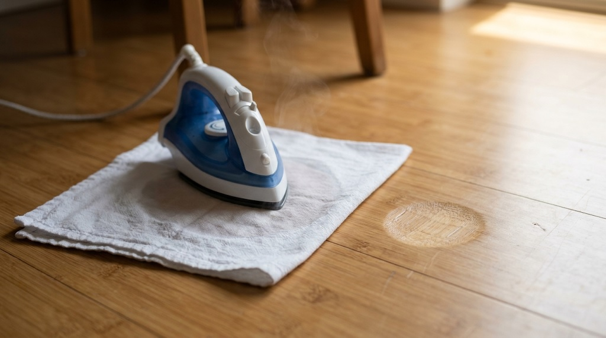
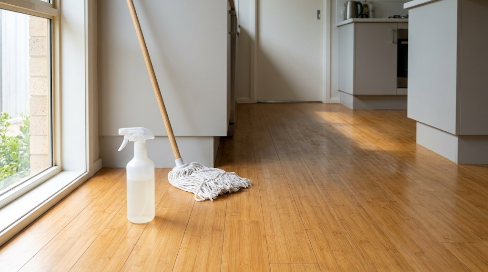
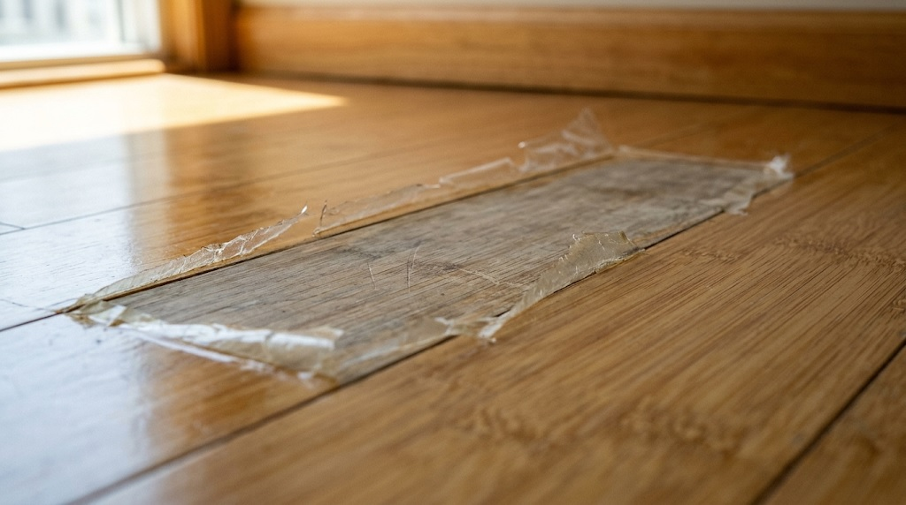
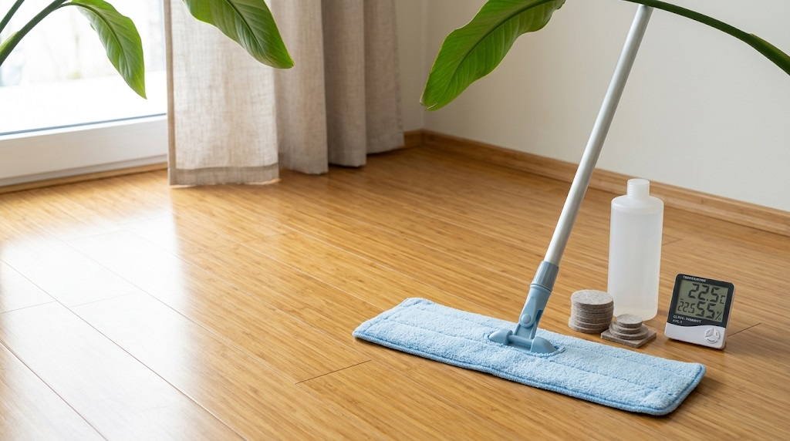

A short video showing someone revive a scratched floor with a tea towel and an iron gets shared because it looks like magic and costs nothing. Some of those clips are genuinely useful. Others will cost you a five thousand dollar floor and a denied claim, and the video never mentions the second part.

The dividing line is not skill or difficulty. It is whether the method puts heat, acid, abrasion, or a new coating onto the factory finish. Warranties on bamboo flooring are written around exactly those four things, and a thirty second clip cannot show you the clause.

## Why a Viral Tip Can Cost You the Warranty

Most bamboo flooring warranties run twenty five to thirty years for residential use, and every one of them is conditional. The coverage assumes the floor was installed to the manufacturer's instructions, kept within a specified humidity range, and cleaned with approved products.

### The clause nobody reads

Buried in the care section is a line saying damage from improper cleaning methods, abrasive products, or unauthorized refinishing is excluded. That sentence covers most of what circulates online. It does not matter that the method worked. It matters that it is not on the approved list.

### Three triggers, one outcome

Moisture, abrasion, and coating changes are the three ways a floor fails a warranty inspection. Heat is usually the accelerant, because heat drives moisture into the core and softens the finish at the same time. When an adjuster looks at a swollen seam, the first question is what was used to clean it.

## The Three Hacks That Actually Work

### Hack one: the low angle flashlight check

Lay a bright flashlight on the floor at one end of a room and look across the surface from the other end with your eye close to the floor. Any cupping, crowning, or lifted seam shows as a shadow line that flat overhead light hides completely.

This one is free and does no harm, and it is the most useful clip in the category. Run it once a season, especially after a humid summer, because catching a cupped edge early is the difference between a repair and a replacement.

### Hack two: steam for a shallow dent

The iron and damp cloth trick works, with limits. Lay a folded cotton cloth over the dent, set an iron to a moderate steam setting, and hold it on the cloth for a few seconds at a time, checking between passes. The steam swells compressed fibers and lifts a shallow dent partway.

It works best on solid strand woven bamboo and barely at all on a thin engineered plank, where there is not enough material to swell. It will not fix a gouge, a chip, or a dent deeper than a fingernail. Keep the iron moving and never set it directly on the floor.

### Hack three: a wax stick for scratches

A hard wax filler stick in a matching tone, warmed slightly and rubbed into a surface scratch, hides the pale line and stops it collecting dirt. It is cosmetic, reversible, and harmless to the finish.

This is the right answer for the light scratches under dining chairs and at doorways. It is not a repair for a scratch that has gone through the wear layer, and it will not survive a wet mop.

## The Five That Void Your Warranty

### Steam mops and soaking wet mopping

This is the most damaging habit in the entire category, and it is the one most often recommended. A steam mop pushes hot vapor into the seams, where it penetrates the core and swells the bamboo from the inside. The finish also softens under sustained heat and takes on a dull, cloudy look that cannot be polished out.

A wet mop that leaves standing water does similar work more slowly, because bamboo is a grass and it moves with moisture. Damp mopping with a well wrung microfiber pad and a pH neutral cleaner is what the manufacturers specify.

### Vinegar and water, the natural cleaner

Vinegar is acidic, and the factory finish on bamboo flooring is a UV cured polyurethane that does not tolerate repeated acid exposure. Used weekly, a vinegar solution dulls the sheen, etches the surface in traffic lanes, and leaves a residue that attracts dirt.

The natural label does a lot of work in those videos. Acid is acid whether it came from a green bottle or a laboratory. Most manufacturers list a pH neutral cleaner by name, and it costs less than vinegar.

### Melamine sponges on scuffs

The white foam eraser that removes marks from walls works by acting as a very fine abrasive. On a bamboo floor it cuts through the finish rather than cleaning it, and it leaves a dull patch that is brighter in raking light than everything around it.

One pass on a scuff will not destroy a floor. Repeated use in the same spot wears through the wear layer, and a worn wear layer is an excluded condition, not a manufacturing defect. A soft eraser or a damp cloth with neutral cleaner handles most scuffs.

### Sanding out a scratch yourself

A hand sander on a small area seems reasonable and almost never ends well. Bamboo grain is straight and dense, and a local pass leaves a visible depression with a different sheen that cannot be matched by hand.

Worse, many bamboo floors have a wear layer thin enough that one pass exposes the core. Once the core shows, the floor is finished and the warranty will not cover it, because unauthorized sanding sits on the exclusion list.

### A fresh coat of polyurethane

A video that says you can refresh a tired floor with water based polyurethane skips the step that matters. A new coat only bonds to a clean, abraded, compatible surface. Applied over a dirty factory finish, it peels within a season, and peeling finish is not a defect the manufacturer accepts.

The legitimate version is a screen and recoat, done by someone who knows the finish chemistry, with a light abrasion first and a compatible product.

## What to Check Before You Try Anything

Read the care section of your warranty before the video, not after. Look for the approved cleaner, the humidity range, and the words unauthorized refinishing. Photograph the label of whatever you plan to use, and keep the receipt for the floor.

### The humidity number matters

Most bamboo warranties specify an indoor relative humidity range, commonly between thirty five and fifty five percent. A floor that fails because a room sat at seventy percent for a summer is a moisture claim, and no cleaning hack caused it or fixed it. A cheap hygrometer tells you whether you have a real problem.

### Keep the paper trail

If a claim happens, the adjuster will ask for the installation date, the installer details, the cleaning products used, and photographs. A folder with those four things turns an argument into a process.

## If You Already Tried One of These

Stop using the method and let the floor dry for a week before judging the damage. Photograph the area in raking light, note the date, and call the dealer you bought from rather than the manufacturer general line, because dealers handle claims and know which inspector to send.

A dull patch from a melamine sponge can sometimes be improved with a matching maintenance product. A swollen seam will not recover, and a sanded-through wear layer needs a plank replacement.

## Questions Homeowners Ask Most

### Does a steam mop really damage bamboo?

Yes. The heat drives moisture into the seams and softens the finish, and the damage accumulates over months rather than appearing at once. It is the single most common cause of denied claims on bamboo floors.

### Will vinegar ruin the finish?

Not in one use. Repeated weekly use dulls and etches the polyurethane, and the change is gradual enough that most people blame the floor instead of the cleaner.

### Can I use a magic eraser on bamboo?

It will remove the mark and cut the finish at the same time. Use it only on a scuff you cannot lift any other way, and accept that the spot will look different afterward.

### Is refinishing always a warranty problem?

Only when it is done wrong. A professional screen and recoat with a compatible product is a legitimate maintenance step on many floors. Do it yourself without checking the clause and it becomes an exclusion.

The pattern across all five is the same. Shortcuts that add heat, acid, abrasion, or an incompatible coating trade a small visible problem for a large invisible one, and the warranty is written to notice the second kind. The three techniques worth keeping are the ones that diagnose, lift, or conceal without touching the chemistry of the finish.

